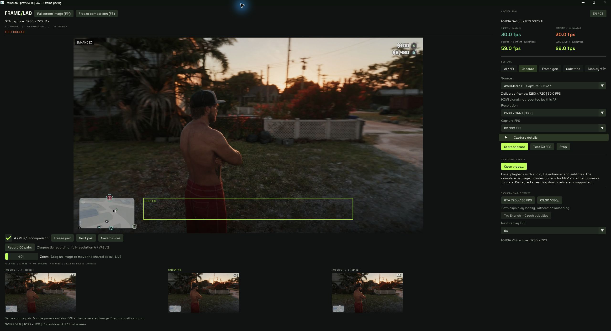
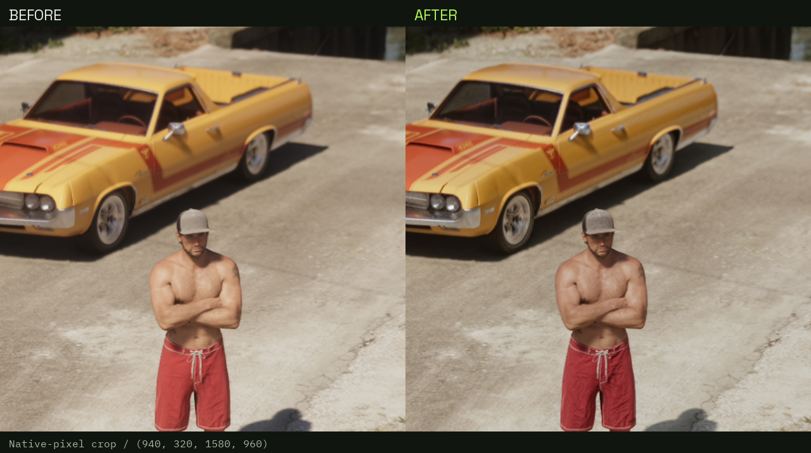
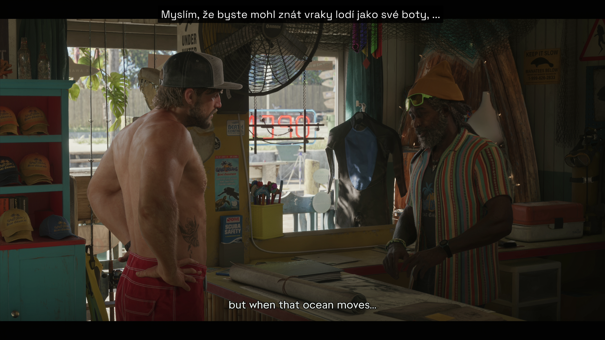

# FrameLab

**Development preview.19 (source only):** optional custom OpenAI-compatible/Ollama servers and experimental conversation memory. The selected model can retain original dialogue in the background; it defaults off and can worsen translations. [Actual OCR → display pilot](https://opicebot.cz/framelab/runs/2026-11-24-context-memory/live.html?lang=en) · [Method and limitations](docs/CONTEXT-LIVE-VALIDATION.md) · [Custom server setup](https://opicebot.cz/framelab/guide/custom-ai-en.html). Public download below remains preview.18; the planned 25 Czech + 50 multilingual context demonstrations are not complete.

**Preview.17:** RIFE / DirectML for suitable non-NVIDIA GPUs, repaired Optical Flow, 40 language choices and TranslateGemma downloads. [Hardware and setup](docs/GPU-BACKENDS.md) · [Multilingual guide](docs/MULTILINGUAL.en.md) · [Measured results](docs/release-preview17.md).

**Preview.18:** CUNI and TranslateGemma can select CUDA, Vulkan or CPU, with an independent translation GPU and optional GPU + RAM placement. Vulkan was exercised on Intel UHD and RTX 4050; AMD hardware remains untested. [Setup and measured limits](docs/local-translation-compute.cs.md).

Capture card or video → GPU → your display. An experimental Windows app for frame generation, optional neural enhancement and local multilingual subtitles.

**[Download preview.18](https://github.com/tomik520i/FrameLab/releases/download/v0.2.0-preview.18/FrameLab-0.2.0-preview.18-windows-x64-full.zip) · [Website & comparisons](https://opicebot.cz/framelab/) · [Česky](docs/README.cs.md)**

[Illustrated setup guide — real screenshots, step by step](https://opicebot.cz/framelab/guide/visual-en.html)

[Preview.16 changes](docs/release-preview16.md) · [Complete 1,747-translation audit](https://opicebot.cz/framelab/runs/2026-11-20-3h/)

Three seconds of the same GTA camera movement, played over twelve seconds. The right side contains the app's recorded generated images; no new interpolation was added during export. [MP4](https://opicebot.cz/framelab/media/gta-2x-slow.mp4) · [Frame IDs, settings and analysis](examples/2026-11-20/README.md).

## What it does

- **Frame generation:** NVIDIA VFG, D3D11 Optical Flow or RIFE 4.22 lite via DirectML, 2× / 3× / 4×. Start at 2×; higher multipliers can produce severe artifacts and latency. RIFE and Optical Flow can use AMD / Intel / NVIDIA; hardware performance still matters. This is video interpolation without game motion vectors, not in-engine DLSS.
- **Optional NR enhancement:** same-frame original/enhanced comparison, strength, processing limit and 1–4 sequential passes. Optional [Eco mode](docs/NR_ECO.md) enhances before FG to reduce AI evaluations. [External runtime setup](docs/enhancer-install.en.md).
- **Local multilingual captions:** 40 language choices and 12 bundled OCR families; TranslateGemma 4B Q4/Q8 or 12B Q4 downloads. CPU OPUS and CUNI Q3/Q5/Q8 remain EN → CS only. Select one subtitle word to learn color/size, mark the reading area and save named profiles.
- **Capture or your own movie:** separate resolution/FPS controls; MP4/MKV playback with audio and subtitle track selection through bundled LibVLC.
- **Full pipeline recording:** input, generated images, before/after enhancement and final image with captions, linked by IDs. Playable clips, SRT and settings JSON; incomplete takes are labeled.
- **Debug & measurement:** timestamped FPS, CPU/GPU load, queues, timings, OCR, translations and settings until logging is stopped. Fullscreen, audio routing, monitor controls and English/Czech UI.

## Start

1. Download the **full Windows x64 ZIP** and **extract all** into a writable folder.
2. Run **Start FrameLab.cmd**. A clean installation opens the GTA demo; later launches restore the saved session. No compiler, Python or SDK installation is needed.
3. Open **Capture** for your card or **Open video…** for a file. Begin with **2×** in Frame gen. **F11** opens fullscreen.

**[English step-by-step guide](START_HERE.md) · [Česká instalace](INSTALL.cs.md) · [Illustrated guide](https://opicebot.cz/framelab/guide/visual-en.html)**

VFG, neural OCR, CPU translation, media codecs and export tools are bundled. GPU translation models download inside the app. External NR DLLs are **not bundled or mirrored** because redistribution permission has not been established. The [import wizard and exact links](docs/enhancer-install.en.md) are included.

## Real captures, including the limits

The new [GTA evidence set](examples/2026-11-20/README.md) includes settings, frame mappings, native PNG crops, full usable clips, Czech SRTs and sanitized debug data.

| 2560 × 1440 camera take, FG 2× Medium | Over 15 seconds |
|---|---:|
| Input images with changed RGB pixels | 29.33/s |
| Generated images recorded | 29.20/s |
| Complete A / generated / B pairs checked | 437 |
| Generated images identical to an endpoint | 0 / 437 |
| Distinct images submitted by the app | 52.07/s |

The generated pixels really differ. That alone does not prove correct motion: inspect edges, HUD and occlusions. This recording did **not** sustain 60 distinct submitted images/s. Submitted frames and DXGI counters do not measure physical monitor scanout or controller-to-photon latency.

[Two enhancer takes](https://opicebot.cz/framelab/#enhancer) compare the **same output ID**, at 1440p, one pass, 100% strength, motion estimation on. One is complete; the other has a **12.28-second** complete prefix. Changed detail is not automatically more faithful detail.

[Three caption takes](https://opicebot.cz/framelab/#subtitles) retain the actual Q5 translations, including mistakes. Complete prefixes: **6.61, 3.70 and 3.46 seconds**. Missing frames or words were not reconstructed. Preview.15 fixes the aggressive GPU-readback timeout that stopped these recordings; memory/disk still limits recording length.

## Performance and focus

**RTX 5070 Ti 16 GB, Ryzen 9 5900X, 64 GB RAM, Windows 11 Pro, AVerMedia GC573**, 2560 × 1440 / 165 Hz monitor, driver 617.14. The user's mixed 20-minute session contains setup, gameplay, recording and export. Median OCR: **333 ms**; capture-to-Czech-caption: **958 ms**; NR worker: **5.83 ms**. These stages overlap and must not be added. [Methodology and data](examples/2026-11-20/README.md).

A controlled replay with FG 2× + NR gave **53.81 submitted FPS foreground, 52.93 behind a maximized window, 54.82 fullscreen**. Severe focus-related loss was not reproduced. Subtitles were off in this isolation test. A process-local timer/QoS experiment gave no material improvement and remains **off by default**. [Measurements](examples/2026-11-20/focus/summary.json).

## Documentation

- [Release notes](docs/release-preview17.md), [build/package](docs/build-preview17.md)
- [OCR profiles](docs/subtitle-ocr.md), [subtitle models](docs/subtitle-model-guide.md), [movies and tracks](docs/local-video.md)
- [Recording](docs/pipeline-recording.md), [debug](docs/debug-measurement.md), [translation experiments](https://opicebot.cz/framelab/translation/)
- [Third-party notices](THIRD_PARTY_NOTICES.md), [runtime distribution](docs/runtime-distribution.md), [sample provenance](docs/sample-provenance.md), [TODO](docs/TODO.md)

Windows x64 and a compatible GPU/driver are required. VFG targets RTX 40/50; Optical Flow is a separate path for other suitable hardware. Actual device support and performance vary. Delivered capture dimensions are displayed; source HDMI timing is not reported by this API. Older Spider-Man 3×/4× examples remain in the repository's historical evidence and releases.

## Support

**[Donate through my Opicebot portal](https://opicebot.cz/?public=prdelniopice&donation2=prdelniopice)** — the donation page is **Czech only**, with PayPal support in **CZK**.

Source: GPL-3.0. Third-party components and game footage retain their own terms. This community experiment is not affiliated with NVIDIA or game publishers.

## New in preview.18: game windows, independent captions and Vulkan

- **Capture → Application window:** refresh, choose the running game or Remote Play window and start capture. Keep the source open; begin with windowed/borderless mode. Protected surfaces and some games cannot be captured. Image processing has its own GPU selection, applied after restart.
- **Display → Subtitles only over source window:** a transparent, click-through overlay follows the selected window. Set the OCR region first and position translated text independently. This mode does not inject FG or NR into the game. [Remote Play, overlay and API walkthrough](https://opicebot.cz/framelab/guide/remote-subtitles-en.html).
- **Subtitles → Translation compute:** Auto, CUDA, Vulkan or CPU, with a separate GPU choice. CUNI and Gemma retain their model files. Optional GPU + RAM allows partial placement. CUDA is fastest on this laptop; Intel UHD Vulkan works but is slow. Physical AMD testing is still outstanding. [Measured setup guide](docs/local-translation-compute.cs.md).
- **Optional OpenAI API:** choose online translation, save your own key and refresh available models. Windows Credential Manager stores the key; OCR text is sent to the selected API. Model profiles govern supported reasoning/temperature parameters. Local models remain usable without a key. The application does not run a paid quality judge.
- A bundled local filter reduces names, license plates and labels; ambiguous text still requires a suitable OCR region. Active playback/capture keeps the display awake without changing the Windows power plan.

[All 2,000 translations, direct assistant review, ranking and examples](https://opicebot.cz/framelab/runs/2026-11-23-direct-review/). The 500-entry benchmark measured text translation with FG, NR and OCR off, not game performance.
