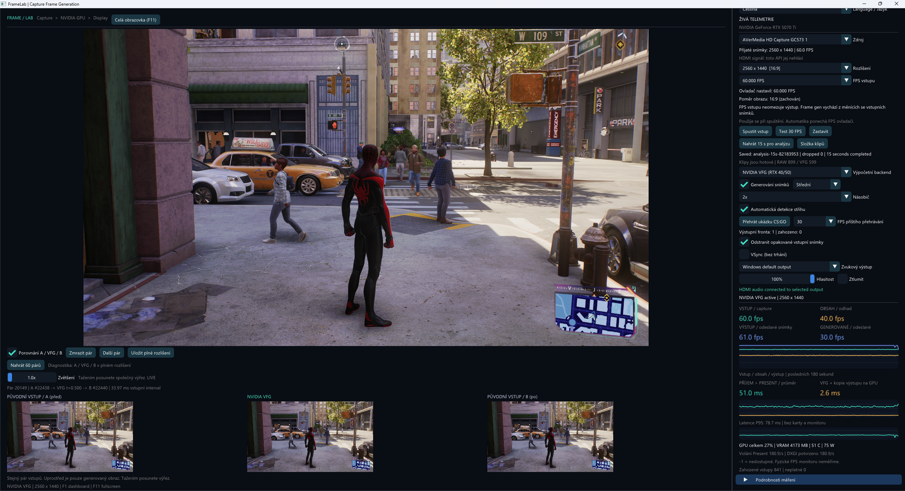
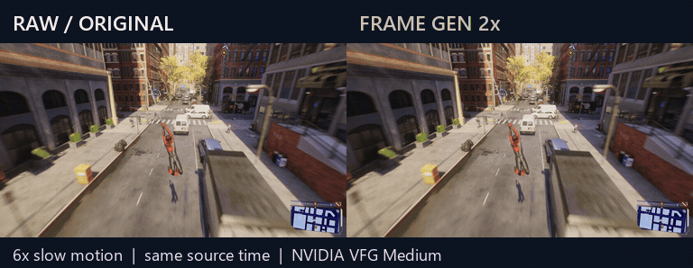

# FrameLab

[Česky / Czech guide](docs/README.cs.md) · [Start here](START_HERE.md) · [2× comparison](examples/82183953/README.md) · [4× artifacts](examples/84744531/README.md) · [Test system / GPU load](docs/test-system.md)

**Capture device → GPU frame interpolation → monitor.** Experimental Windows desktop application, independent of the connected console, camera or second PC. English UI by default; select **Language / Jazyk → Čeština** for Czech. Driver messages and technical diagnostics remain in English.



*User-provided screenshot of the Czech UI. These are live counters after recording, not the averages from the benchmark below.*

**Same movement, extra frames on the right.** RAW versus NVIDIA VFG 2×, slowed 6× — one second of gameplay stretched to six.



*Timing is aligned to the source, so processing delay is removed. [Full video](https://github.com/tomik520i/FrameLab/releases/download/v0.2.0-preview.6/analysis-15s-82183953_source-aligned_3s_4x-slow.mp4) · [Settings and artifacts](examples/82183953/README.md) · [GIF frame mapping](docs/images/framelab-2x-slow-comparison.json)*

## Download and start

Download the [ready-to-run Windows ZIP](https://github.com/tomik520i/FrameLab/releases/download/v0.2.0-preview.6/FrameLab-0.2.0-preview.6-windows-x64.zip) from [Releases](https://github.com/tomik520i/FrameLab/releases/tag/v0.2.0-preview.6), extract the whole ZIP, then double-click **Start FrameLab - Optical Flow.cmd**. Select your capture device, resolution and audio output, then click **Start capture**. No compiler, Python or NVIDIA AI model is needed for this route. The experimental Optical Flow backend has different quality from NVIDIA VFG.

For NVIDIA VFG on RTX 40/50, follow the linked downloads and steps in [Start here](START_HERE.md#nvidia-vfg--rtx-4050). NVIDIA's separately licensed runtime is not bundled. The **Source code** archive is for building, not the ready-to-run application. The release also includes matching source and both measured gameplay examples.

## Backends

| Backend | Intended GPU support | Status |
| --- | --- | --- |
| NVIDIA Video Frame Generation (Maxine) | Windows Ada / Blackwell, including GeForce RTX 40 / 50 | Tested locally on RTX 5070 Ti; RTX 40 not hardware-tested here |
| D3D11 Optical Flow | NVIDIA GPUs with Direct3D feature level 11 / Shader Model 5, including RTX 20 / 30 / 40 / 50 | Experimental block matching + motion warping; tested only on RTX 5070 Ti |
| Native preview | NVIDIA Direct3D 11 adapter | No interpolation |

Optical Flow does not require CUDA runtime DLLs or NVIDIA AI models at runtime. It is **not DLSS, NVIDIA Optical Flow SDK, or equivalent in quality to the Maxine model**. It can smear edges, ghost occlusions and fail on fast motion / scene cuts. Maxine support is defined by [NVIDIA's VFG documentation](https://docs.nvidia.com/maxine/vfx/latest/Filters/VideoFrameGeneration.html), not the availability of DLSS in a game. No measured RTX 20/30 performance is claimed.

## Run

Launch `Start FrameLab.cmd`. Choose a **Source**, **Resolution**, **Capture FPS**, audio **Output**, and **Start capture**. Enable **Frame generation**, select the backend, start with **2× / Medium**. Quality and automatic cut detection apply to NVIDIA only. 3×/4× are experimental and can amplify artifacts.

Resolution and capture FPS are separate. **Automatic (device)** leaves the choice to the driver; it does not detect HDMI wire timings. Choose an explicit resolution to request FPS. FPS options include advertised defaults and common rates inside `MinFrameInterval` / `MaxFrameInterval`; a range is not a guarantee that every value is supported. The driver can reject or round requests. FrameLab reads `GetFormat` after negotiation and separately shows measured callback FPS. No global 60-FPS output cap is introduced by capture selection.

On the local GC573 driver, the capability ranges reach 4K60, 1440p144, 1080p240, and 3440×1440 at 100 FPS. These are driver reports, not hardware tests with high-refresh source signals. Input frame changes still determine interpolation cadence; a 40-FPS game captured at 120 Hz remains approximately 40 unique FPS.

Resolutions list their aspect ratio: 16:9, 16:10, 4:3, ultrawide or any other dimensions the driver advertises. 3440×1440 is exactly 43:18 (commonly marketed as 21:9). Preview and fullscreen preserve the delivered pixel aspect ratio without stretching. 4K is native capture dimensions, not AI upscaling. Raw/generated diagnostics retain the capture dimensions.

The FPS negotiation follows [Microsoft's documented procedure](https://learn.microsoft.com/en-us/windows/win32/directshow/configure-the-video-output-format): set `AvgTimePerFrame`, call `SetFormat`, then query the actual format.

Any DirectShow source convertible by the installed graph to BGRA8 may work; this is not a promise of every card, compressed format or network source. Only AVerMedia GC573 has been locally exercised so far. No HDR pipeline or HDCP bypass is implemented. Move the window to the desired monitor; **F11** shows only the main image and **Escape** returns. HDMI passthrough from the capture card does not contain generated frames.

Audio routes to the selected DirectSound output. Volume, mute and output persist. Audio latency and A/V synchronization are not measured. Close other programs holding the capture device.

## Build

Windows x64, Visual Studio 2022 C++ Build Tools + Windows SDK, CMake, Python 3.11+ (dependency setup / optional diagnostics). Git is optional for ZIP builds.

```powershell
.\tools\setup-deps.ps1
.\build.ps1
ctest --test-dir build -C Release --output-on-failure
```

Dependencies are pinned in the setup script. CUDA headers are needed to build the optional NVIDIA implementation, but no CUDA compiler is needed. To run NVIDIA VFG, obtain the matching VFX SDK 1.3 core + VFG feature from [NVIDIA](https://docs.nvidia.com/maxine/vfx/latest/WindowsVFXSDK/InstalltheVFXSDK.html), accept its terms yourself, and import the required runtime DLLs:

```powershell
.\tools\import-runtime.ps1 -RuntimeDirectory 'C:\path\to\your\runtime'
```

The public package excludes NVIDIA runtime/model files. D3D11 Optical Flow works without them. Missing runtime leaves native preview available with a visible error. The application is unsigned; no security settings are changed.

## Timing and diagnostics

Compute and presentation are separated by a bounded GPU texture queue. A presentation clock spaces content submissions; a late result rebases instead of producing a catch-up burst. This adds buffering latency. Overload can still drop source / output frames; counters are visible. VSync and monitor refresh can limit actual display cadence. No claim of perfect VRR timing or physical monitor FPS is made.

- Input: capture callbacks, including duplicates.
- Content: changed captured pixels, not the source engine FPS.
- Output: submitted image IDs, including SDK copy fallbacks; not unique scanout frames.
- Windows confirmed: observed DXGI display confirmations resolved to raw/generated image IDs. This is a conservative sampled rate; it excludes repeated IDs, but different IDs can contain identical pixels. Missing confirmation data is shown as unavailable. The display's current Windows mode and last confirmed image ID are shown separately. This is not a physical camera measurement.
- Latency: capture callback to Present return; excludes source rendering, capture hardware buffering and monitor scanout.
- GPU time: backend GPU work; utilization is whole-device including other apps.

**Record 15 s analysis** buffers raw and generated frames with background **lossless RAM compression**, then writes the original BGRA bytes and exports clips. It preserves every pixel and supports 2×/3×/4× through the same bounded buffer. Preflight leaves 12 GiB for the system and checks estimated disk needs before creating a folder. Incompressible data or slow compression can still fill the budget; the recording then stops with an explicit reason. Playback at 4K does not require that recorder RAM budget. No data is automatically deleted. This diagnostic can affect timing. No audio is recorded. New takes also save sampled Windows image-ID confirmations. For a portable build, install optional clip-export dependencies with `tools/setup-diagnostics.ps1`. See [recording format](docs/recordings.md).

```powershell
app\FrameLab.exe --verify-core
app\FrameLab.exe --verify-vfg
app\FrameLab.exe --verify-vfg --optical
app\FrameLab.exe --demo --fg --medium --1440 --no-vsync --verify-pacing --seconds 25
app\FrameLab.exe --demo --fg --optical --1440 --no-vsync --verify-pacing --seconds 25
```

These synthetic runs do not start an analysis recording. `--verify-pacing` writes lightweight submission timestamps. A source moving at 40 FPS inside 60-Hz capture should not be described as 30→60.

## Examples and distribution

[4× artifact example: 84744531](examples/84744531/README.md): severe doubled character contours and background warping. Includes all three generated phases of the same source pair and slow motion. This diagnostic take reached 87.87 submitted IDs/s and 87.80 Windows-confirmed IDs/s; more FPS did not mean clean images. These are different gameplay runs, not a controlled same-input 2×/4× benchmark.

[Test system and normal live GPU load](docs/test-system.md): Ryzen 9 5900X, RTX 5070 Ti, 64 GB RAM, AVerMedia GC573. Measurements are taken during live generation without analysis recording or export.

[New measured gameplay comparison: 82183953](examples/82183953/README.md): 15 seconds of 1440p capture, 40 changing source images/s and 80 submitted image IDs/s. Includes a 3-second action segment at 4× slow motion, actual submission timing, full-resolution frames, native-pixel character/HUD crops, settings and failure cases. This is NVIDIA VFG Medium 2×, not the Optical Flow backend. Image-ID counts are not physical monitor FPS or a quality score.

[Existing gameplay example](examples/79277359/README.md) documents a **pre-fix** 15-second take, including visible errors. It is not evidence that the new scheduler or optical backend fixes those images. Compact clips and matched metadata are prepared separately as release assets, not committed as raw pixel dumps. [Release preparation](docs/releasing.md) explains packaging and reproducible comparisons.

GPL-3.0 source. Dependencies retain their own licenses; see [third-party notices](THIRD_PARTY_NOTICES.md). Experimental software, not a production compatibility certification.

## Support development

If you would like to support FrameLab, you can [donate via my Opicebot portal](https://opicebot.cz/?public=prdelniopice&donation2=prdelniopice), which I also use for my Twitch bot. Donations are in **CZK via PayPal**. **The donation page is available in Czech only.** Donations are optional; FrameLab remains free.
