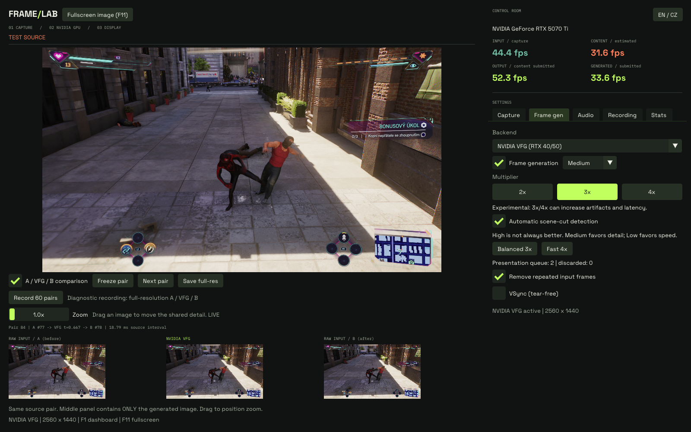

# FrameLab

**[CUNI Q3 vs Q8 on RTX 5070 Ti: speed, memory and all 300 translations](https://opicebot.cz/framelab/translation/)**

**Preview.13: [Download the complete Windows app](https://github.com/tomik520i/FrameLab/releases/download/v0.2.0-preview.13/FrameLab-0.2.0-preview.13-windows-x64-full.zip) · [Česká instalace krok za krokem](INSTALL.cs.md) · [English installation](START_HERE.md) · [All release files](https://github.com/tomik520i/FrameLab/releases/tag/v0.2.0-preview.13)**

English-picture subtitles → local Czech overlay, now with optional CUNI Q3/Q8 GPU models, resumable downloads and independently draggable placement. Missing Windows OCR can be installed from Subtitles with administrator approval. [English subtitle setup](docs/subtitle-model-guide.md) · [Český návod titulků](docs/subtitle-model-guide.cs.md). Both gameplay clips and monitor/display controls are included. The release ZIP includes the model, Python, NVIDIA VFG, export tools and licenses. NR adapter and import wizard are included. External NR DLLs require a separate community download; [Czech setup](docs/enhancer-install.cs.md) / [English setup](docs/enhancer-install.en.md) give exact links, steps and licensing limits. The website provides the same complete preview.13 download and shows [real enhancer comparisons](https://opicebot.cz/framelab/#enhancer).

[Website / downloads](https://opicebot.cz/framelab/) · [Česky / Czech guide](docs/README.cs.md) · [Start here](START_HERE.md) · [2× comparison](examples/82183953/README.md) · [3× comparison](examples/112947656/README.md) · [3× combat](examples/113768562/README.md) · [4× artifacts](examples/84744531/README.md) · [Test system / GPU load](docs/test-system.md)

**Capture device → GPU frame interpolation → monitor.** Experimental Windows desktop application, independent of the connected console, camera or second PC. The complete preview.13 ZIP starts in English; select **EN / CZ** for Czech. A source-only build defaults to English. Driver messages and technical diagnostics remain in English.



*Preview.9 interface with replayed RAW gameplay. Its counters describe this layout preview, not a live performance benchmark. Capture, frame gen, audio, recording and detailed statistics have separate tabs.*

**Same movement, extra frames on the right.** RAW versus NVIDIA VFG 2×, slowed 6× — one second of gameplay stretched to six.


*Timing is aligned to the source, so processing delay is removed. [Full video](https://github.com/tomik520i/FrameLab/releases/download/v0.2.0-preview.6/analysis-15s-82183953_source-aligned_3s_4x-slow.mp4) · [Settings and artifacts](examples/82183953/README.md) · [GIF frame mapping](docs/images/framelab-2x-slow-comparison.json)*

**New: original versus 3×, slowed 6×.** Recorded 1080p gameplay, NVIDIA VFG Medium.


*Source-time alignment removes processing delay; this GIF is not a monitor-FPS or latency measurement. [Full video](https://github.com/tomik520i/FrameLab/releases/download/v0.2.0-preview.7/analysis-15s-112947656_source-aligned_3s_4x-slow.mp4) · [3× analysis and artifacts](examples/112947656/README.md) · [GIF frame mapping](docs/images/framelab-3x-slow-comparison.json). This take is 1080p; the 2× example above is a different 1440p gameplay run.*

## Download and start

1. Download the **[complete Windows x64 ZIP](https://github.com/tomik520i/FrameLab/releases/download/v0.2.0-preview.13/FrameLab-0.2.0-preview.13-windows-x64-full.zip)** from [preview.13](https://github.com/tomik520i/FrameLab/releases/tag/v0.2.0-preview.13). GitHub's automatic **Source code** download is not a runnable package.
2. Right-click → **Extract all**, then open **1 - Spustit FrameLab.cmd**. The bundled CS:GO video plays immediately; no capture card is needed for the demo.
3. Use **2 - NVIDIA RTX 40-50.cmd** for VFG 2×, or **3 - Optical Flow.cmd** for the alternative. **Capture / Vstup** contains Spider-Man and a separate artificial subtitle demo.

No Python/pip/model/SDK/compiler installation is required. Keep every folder together. Windows x64 and compatible installed GPU/capture drivers are required. English OCR is a Windows language component; if absent, the application explains how to install it once. Translation subsequently runs offline.

**[Complete installation, controls and troubleshooting](START_HERE.md)** · **[Český návod](INSTALL.cs.md)** · [Component licenses/provenance](docs/runtime-distribution.md). The website and GitHub provide the same complete preview.13 package.

## Illustrated setup and fullscreen guides

[Česky: obrazový návod](https://opicebot.cz/framelab/guide/visual.html) · [English illustrated guide](https://opicebot.cz/framelab/guide/visual-en.html). Real Windows screenshots with separate numbered annotations cover download, extraction, both games, VFG, graphical NR import, same-frame comparison and local Czech subtitles. Images appear beside the existing text guides and are included offline as **OBRAZOVY NAVOD.html / VISUAL GUIDE.html**. The same CZ/EN guides are online and offline. [Clean fullscreen](https://opicebot.cz/framelab/guide/fullscreen.html) automatically hides all comparison views, controls, labels and the OCR outline; the cursor hides after two idle seconds. No external NR model DLLs are bundled.

## New in preview.13

- **Sharper Czech subtitles:** dedicated font raster sizes for output resolutions up to 4K, drawn after enhancement instead of enlarging the 17px UI font.
- **Clean fullscreen:** F11 shows one final processed image with enabled subtitles. Preview comparisons and frozen comparison state are automatically removed from the fullscreen output. Esc/F11 returns to settings; the selected comparison remains available in the window.
- **Draggable NR comparison:** drag the split divider directly in the settings preview; F8 freezes a matching pair. Fullscreen always displays the final enhanced image at the configured strength when NR is enabled.
- **Illustrated guides:** actual Windows screenshots, numbered arrows, zoomable images and a dedicated fullscreen walkthrough, all bundled offline in Czech and English.

### Also included

The native Windows title bar now matches FrameLab's dark colors on Windows 11, preserving standard window controls, resizing and Snap. Older Windows versions fall back to supported system styling.

- **Subtitles / Titulky:** Windows OCR reads a selectable English subtitle region. Use the bundled OPUS-MT CPU translator or download CUNI-MH Q3/Q8 in the app. Drag Czech text and its background independently, place it above/below the original, and keep multiline captions within the visible window even in cropped views. No STT, microphone, cloud or API key. [Setup and models](docs/subtitle-model-guide.md).
- **Bundled tests:** CS:GO 1080p60, Spider-Man 540p60, and a clearly labeled artificial OCR test. Both gameplay clips are three-second loops, not full games. [Sources and content rights](docs/sample-provenance.md).
- **Display / Zobrazení:** monitor selection, window sizes, fit/fill/1:1 and fullscreen. Capture resolution/FPS follow driver modes; display controls do not change Windows refresh rate.
- **NR ready, without NR model DLLs:** the executable, SDK-free adapter and import wizard are bundled. Run `4 - Doplnit enhancer.cmd` or AI / NR → Set up / check enhancer. Exact external download, hash-checked import, source notices and troubleshooting: [NR setup](docs/enhancer-install.en.md). External hosting does not grant usage/redistribution rights. VFG remains a separate bundled feature.

Pipeline: capture/video → selected frame-generation backend → optional NR enhancement → Czech overlay → display. More processing can add latency/drop frames; it does not guarantee multiplied display FPS.

## Backends

| Backend | Intended GPU support | Status |
| --- | --- | --- |
| NVIDIA Video Frame Generation (Maxine) | Windows Ada / Blackwell, including GeForce RTX 40 / 50 | Tested on RTX 5070 Ti and RTX 4050 Laptop |
| D3D11 Optical Flow | NVIDIA GPUs with Direct3D feature level 11 / Shader Model 5, including RTX 20 / 30 / 40 / 50 | Experimental block matching + motion warping; tested on RTX 5070 Ti and RTX 4050 Laptop |
| Native preview | NVIDIA Direct3D 11 adapter | No interpolation |

Optical Flow does not require CUDA runtime DLLs or NVIDIA AI models at runtime. It is **not DLSS, NVIDIA Optical Flow SDK, or equivalent in quality to the Maxine model**. It can smear edges, ghost occlusions and fail on fast motion / scene cuts. Maxine support is defined by [NVIDIA's VFG documentation](https://docs.nvidia.com/maxine/vfx/latest/Filters/VideoFrameGeneration.html), not the availability of DLSS in a game. No measured RTX 20/30 performance is claimed.

## Run

Launch `Start FrameLab.cmd`. Choose a **Source**, **Resolution**, **Capture FPS**, audio **Output**, and **Start capture**. Enable **Frame generation**, select the backend, start with **2× / Medium**. Quality and automatic cut detection apply to NVIDIA only. 3×/4× are experimental and can amplify artifacts.

Resolution and capture FPS are separate. **Automatic (device)** leaves the choice to the driver; it does not detect HDMI wire timings. Choose an explicit resolution to request FPS. FPS options include advertised defaults and common rates inside `MinFrameInterval` / `MaxFrameInterval`; a range is not a guarantee that every value is supported. The driver can reject or round requests. FrameLab reads `GetFormat` after negotiation and separately shows measured callback FPS. No global 60-FPS output cap is introduced by capture selection.

On the local GC573 driver, the capability ranges reach 4K60, 1440p144, 1080p240, and 3440×1440 at 100 FPS. These are driver reports, not hardware tests with high-refresh source signals. Input frame changes still determine interpolation cadence; a 40-FPS game captured at 120 Hz remains approximately 40 unique FPS.

Resolutions list their aspect ratio: 16:9, 16:10, 4:3, ultrawide or any other dimensions the driver advertises. 3440×1440 is exactly 43:18 (commonly marketed as 21:9). Preview and fullscreen preserve the delivered pixel aspect ratio without stretching. 4K is native capture dimensions, not AI upscaling. Raw/generated diagnostics retain the capture dimensions.

The FPS negotiation follows [Microsoft's documented procedure](https://learn.microsoft.com/en-us/windows/win32/directshow/configure-the-video-output-format): set `AvgTimePerFrame`, call `SetFormat`, then query the actual format.

Any DirectShow source convertible by the installed graph to BGRA8 may work; this is not a promise of every card, compressed format or network source. Only AVerMedia GC573 has been locally exercised so far. No HDR pipeline or HDCP bypass is implemented. Move the window to the desired monitor; **F11** shows only the main image and **Escape** returns. HDMI passthrough from the capture card does not contain generated frames.

Audio routes to the selected DirectSound output. Volume, mute and output persist. Audio latency and A/V synchronization are not measured. Close other programs holding the capture device.

## Build

[Complete preview.13 build/package instructions](docs/build-preview13.md). Standard builds include the SDK-free adapter (`FRAMELAB_EXPERIMENTAL_NR=ON`); model DLLs are never fetched during the build.

Windows x64, Visual Studio 2022 C++ Build Tools + Windows SDK, CMake, Python 3.11+ (dependency setup / optional diagnostics). Git is optional for ZIP builds.

```powershell
.\tools\setup-deps.ps1
.\build.ps1
ctest --test-dir build -C Release --output-on-failure
```

Dependencies are pinned in the setup script. CUDA headers are needed to build the optional NVIDIA implementation, but no CUDA compiler is needed. To run NVIDIA VFG, obtain the matching VFX SDK 1.3 core + VFG feature from [NVIDIA](https://docs.nvidia.com/maxine/vfx/latest/WindowsVFXSDK/InstalltheVFXSDK.html), accept its terms yourself, and import the required runtime DLLs:

```powershell
.\tools\import-runtime.ps1 -RuntimeDirectory 'C:\path\to\your\runtime'
```

A source-only build excludes external runtime/model files. The complete release ZIP includes the separate official NVIDIA VFG runtime and the CPU translation model, but no NR runtime. D3D11 Optical Flow works without NVIDIA model DLLs. Missing runtime leaves native preview available with a visible error. The application is unsigned; no security settings are changed.

## Timing and diagnostics

Compute and presentation are separated by a bounded GPU texture queue. A presentation clock spaces content submissions; a late result rebases instead of producing a catch-up burst. This adds buffering latency. Overload can still drop source / output frames; counters are visible. VSync and monitor refresh can limit actual display cadence. No claim of perfect VRR timing or physical monitor FPS is made.

- Input: capture callbacks, including duplicates.
- Content: changed captured pixels, not the source engine FPS.
- Output: submitted image IDs, including SDK copy fallbacks; not unique scanout frames.
- Windows confirmed: observed DXGI display confirmations resolved to raw/generated image IDs. This is a conservative sampled rate; it excludes repeated IDs, but different IDs can contain identical pixels. Missing confirmation data is shown as unavailable. The display's current Windows mode and last confirmed image ID are shown separately. This is not a physical camera measurement.
- Latency: capture callback to Present return; excludes source rendering, capture hardware buffering and monitor scanout.
- GPU time: backend GPU work; utilization is whole-device including other apps.

**Record 15 s analysis** buffers raw and generated frames with background **lossless RAM compression**, then writes the original BGRA bytes and exports clips. It preserves every pixel and supports 2×/3×/4× through the same bounded buffer. Preflight leaves 12 GiB for the system and checks estimated disk needs before creating a folder. Incompressible data or slow compression can still fill the budget; the recording then stops with an explicit reason. Playback at 4K does not require that recorder RAM budget. No data is automatically deleted. This diagnostic can affect timing. No audio is recorded. New takes also save sampled Windows image-ID confirmations. The **complete preview.13 bundle includes the clip-export dependencies**; older minimal packages can use `tools/setup-diagnostics.ps1`. See [recording format](docs/recordings.md).

```powershell
app\FrameLab.exe --verify-core
app\FrameLab.exe --verify-vfg
app\FrameLab.exe --verify-vfg --optical
app\FrameLab.exe --demo --fg --medium --1440 --no-vsync --verify-pacing --seconds 25
app\FrameLab.exe --demo --fg --optical --1440 --no-vsync --verify-pacing --seconds 25
```

These synthetic runs do not start an analysis recording. `--verify-pacing` writes lightweight submission timestamps. A source moving at 40 FPS inside 60-Hz capture should not be described as 30→60.

## Examples and distribution

[3× combat: 113768562](examples/113768562/README.md): **1440p with VSync on**, 39.8 changing input images/s → 90.6 submitted/Windows-observed IDs/s, 89.87 known submitted RGB changes/s. Three seconds of fighting slowed to twelve, both kick phases, ghost limbs, distorted aiming reticle and complete settings. [Slowed combat MP4](https://github.com/tomik520i/FrameLab/releases/download/v0.2.0-preview.7/analysis-15s-113768562_source-aligned_3s_4x-slow.mp4). Different resolution, VSync and action from the 1080p take below; not a controlled comparison.

[New 3× gameplay: 112947656](examples/112947656/README.md): 1080p, 40 changing input images/s, 110.8 submitted/Windows-observed IDs/s and 105.6 known RGB changes/s. Includes both 3× phases, ghosting/HUD failure cases, 74 exact endpoint copies, and original settings. This is a different scene and resolution from the older 1440p examples.

[4× artifact example: 84744531](examples/84744531/README.md): severe doubled character contours and background warping. Includes all three generated phases of the same source pair and slow motion. This diagnostic take reached 87.87 submitted IDs/s and 87.80 Windows-confirmed IDs/s; more FPS did not mean clean images. These are different gameplay runs, not a controlled same-input 2×/4× benchmark.

[Test system and normal live GPU load](docs/test-system.md): Ryzen 9 5900X, RTX 5070 Ti, 64 GB RAM, AVerMedia GC573. Measurements are taken during live generation without analysis recording or export.

[3× / 4× tuning experiments](docs/vfg-tuning.md): repeated original-video playback, quality/cut sweeps, native artifact crops and latency measurements. Included in preview.7.

[New measured gameplay comparison: 82183953](examples/82183953/README.md): 15 seconds of 1440p capture, 40 changing source images/s and 80 submitted image IDs/s. Includes a 3-second action segment at 4× slow motion, actual submission timing, full-resolution frames, native-pixel character/HUD crops, settings and failure cases. This is NVIDIA VFG Medium 2×, not the Optical Flow backend. Image-ID counts are not physical monitor FPS or a quality score.

[Existing gameplay example](examples/79277359/README.md) documents a **pre-fix** 15-second take, including visible errors. It is not evidence that the new scheduler or optical backend fixes those images. Compact clips and matched metadata are prepared separately as release assets, not committed as raw pixel dumps. [Release preparation](docs/releasing.md) explains packaging and reproducible comparisons.

GPL-3.0 source. Dependencies retain their own licenses; see [third-party notices](THIRD_PARTY_NOTICES.md). Experimental software, not a production compatibility certification.

## Support development

If you would like to support FrameLab, you can [donate via my Opicebot portal](https://opicebot.cz/?public=prdelniopice&donation2=prdelniopice), which I also use for my Twitch bot. Donations are in **CZK via PayPal**. **The donation page is available in Czech only.** Donations are optional; FrameLab remains free.
