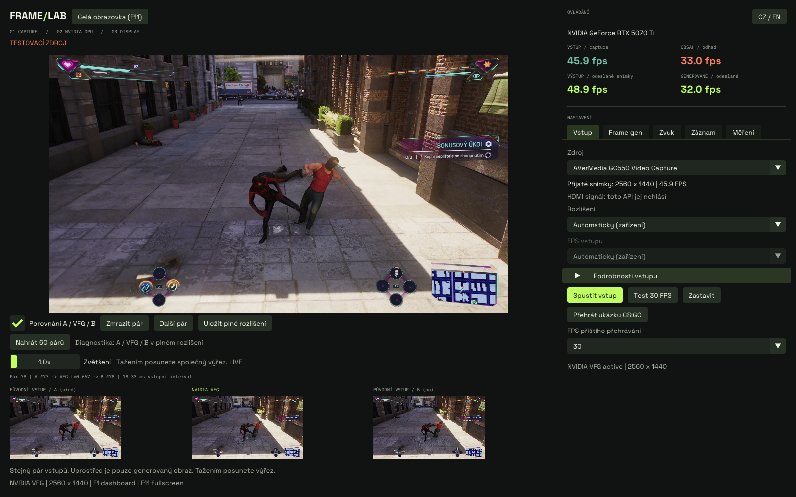
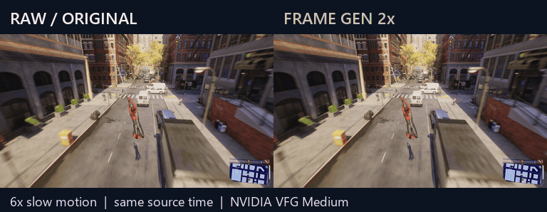

# FrameLab — český návod

[English / hlavní README](../README.md) · [Podrobný postup spuštění a odkazy](../START_HERE.md) · [Nové porovnání](../examples/82183953/README.cs.md)

[Ladění 3× / 4× na stejných nahrávkách](vfg-tuning.cs.md): měření odezvy, kvalita Low/Medium/High a výřezy artefaktů. Součást verze preview.7.

Obecný vstup z capture zařízení → generování mezisnímků na NVIDIA GPU → monitor. Připojit lze konzoli, druhé PC nebo jiný zdroj, který podporuje vaše střihová karta. Výchozí jazyk aplikace je **angličtina**; vpravo nahoře vyberte tlačítko **EN / CZ**. Technické chyby a část diagnostiky mohou zůstat anglicky.

Rozhraní preview.9 při přehrávání dříve nahraného RAW obrazu. Jde o ukázku rozložení, nikoli nové měření výkonu při hraní. Vstup, frame gen, zvuk, záznam a měření mají samostatné záložky.

**Stejný pohyb, vpravo snímky navíc.** Vlevo originál, vpravo NVIDIA VFG 2×. Jedna sekunda hraní zpomalená na šest.

*Obě strany jsou srovnané podle času zdroje; zpoždění zpracování je odstraněné. [Plné video](https://github.com/tomik520i/FrameLab/releases/download/v0.2.0-preview.6/analysis-15s-82183953_source-aligned_3s_4x-slow.mp4) · [Nastavení a artefakty](../examples/82183953/README.cs.md)*

**Nově: originál proti 3×, zpomalení 6×.** Nahrávka v 1080p, NVIDIA VFG Medium.

*Čas je zarovnaný podle zdroje, zpoždění zpracování odstraněné. [Plné video](https://github.com/tomik520i/FrameLab/releases/download/v0.2.0-preview.7/analysis-15s-112947656_source-aligned_3s_4x-slow.mp4) · [Analýza 3× a artefakty](../examples/112947656/README.cs.md). Tato ukázka je v 1080p; starší 2× ukázka nad ní pochází z jiného 1440p záznamu.*

## Stažení a nejjednodušší spuštění

1. Stáhněte [kompletní aplikaci pro Windows](https://opicebot.cz/framelab/downloads/FrameLab-0.2.0-preview.9-windows-x64-full.zip) z [vlastního webu FrameLabu](https://opicebot.cz/framelab/) ([zrcadlo na GitHubu](https://github.com/tomik520i/FrameLab/releases/tag/v0.2.0-preview.9)). Obsahuje NVIDIA DLL i přenosný Python a exportér klipů. Nemusíte instalovat SDK, Python, Git ani kompilátor. Ovladače GPU a střihovky musí být funkční.
2. Rozbalte **celý ZIP**. Pro RTX 40/50 spusťte **Start FrameLab - NVIDIA.cmd**; pro alternativní algoritmus **Start FrameLab - Optical Flow.cmd**. Oba spouštěče zapínají generování 2×.
3. Vyberte **Zdroj**, **Rozlišení**, **FPS vstupu** a **Zvukový výstup**. Klikněte na **Spustit vstup**. Pro první pokus stačí 1080p nebo automatický režim zařízení.

Požadavky: Windows x64, NVIDIA GPU, ovladač GPU a capture zařízení podporující DirectShow. Fyzicky je zatím ověřená RTX 5070 Ti a AVerMedia GC573. Ovladače: [NVIDIA](https://www.nvidia.com/Download/index.aspx), [AVerMedia](https://www.avermedia.com/support/download).

**Optical Flow má jinou kvalitu než NVIDIA VFG v ukázkách.** Je navržené i pro RTX 20/30, které zde nebyly fyzicky otestované. Začněte 2×; 3×/4× mohou výrazně přidat artefakty.

## NVIDIA VFG na RTX 40/50

**Kompletní preview.9 už obsahuje všech pět potřebných NVIDIA DLL**, ověřených proti oficiálnímu balíčku a digitálním podpisům NVIDIA. Nejsou vázané na konkrétní 5070 Ti: Windows runtime podporuje Ada/Blackwell, tedy RTX 40/50. Fyzicky je zde ověřená jen 5070 Ti. Licence NVIDIA jsou přiložené odděleně od GPL aplikace.

Pro starší instalaci lze stáhnout [NVIDIA runtime doplněk pro FrameLab](https://opicebot.cz/framelab/downloads/FrameLab-NVIDIA-VFG-1.3-addon.zip) a jeho složku **app** sloučit se složkou app ve FrameLabu. Původní manuální cesta přes SDK je stále popsaná v [Start here](../START_HERE.md#manual-nvidia-runtime-setup-for-older-minimal-packages). [Původ součástí a licence](runtime-distribution.md).

## Ovládání a řešení problémů

- **F11** zobrazí hlavní obraz přes celou obrazovku, **Escape** vrátí panel. Poměr obrazu zůstává zachovaný i při změně velikosti okna.
- Rozlišení a vstupní FPS se vybírají zvlášť podle možností ovladače. 4K se objeví, pokud ho ovladač nabízí. Rozlišení přijatých snímků je zobrazené samostatně; není to měření HDMI signálu.
- Když není obraz, ověřte správný zdroj a náhled v aplikaci výrobce karty. Zavřete další aplikace používající tutéž kartu; zkuste 1080p a automatické FPS.
- 60 vstupních FPS může obsahovat jen 40 různých obrazů. Generování vychází z měnícího se obsahu. FPS odeslaných obrazů nejsou změřená fyzická FPS monitoru.
- **WINDOWS / ověřená ID** ukazuje snímky, jejichž zobrazení Windows potvrdil a aplikace ho přiřadila ke konkrétnímu RAW nebo generovanému ID. Je to dolní mez zachycených potvrzení; opakované ID se nepočítá znovu, ale kopie pixelů ze SDK může mít nové ID. Vedle je zvlášť ověřená generovaná část a aktuální režim monitoru. Když data chybí, údaj je označený jako nedostupný. Není to měření displeje kamerou.
- Zvuk lze směrovat na zvolený výstup, ztišit či vypnout. A/V synchronizace se neměří.

## Porovnávací materiály a nahrávání

[Nový souboj ve 3×: 113768562](../examples/113768562/README.cs.md): **1440p, zapnutý VSync**, 39,8 změn vstupu/s → 90,6 odeslaných i Windows pozorovaných ID/s, 89,87 známých změn RGB/s. [Tři sekundy boje zpomalené na dvanáct](https://github.com/tomik520i/FrameLab/releases/download/v0.2.0-preview.7/analysis-15s-113768562_source-aligned_3s_4x-slow.mp4), výřezy kopu, duchové končetin, deformovaný zaměřovač a kompletní nastavení. [První nová 3× ukázka](../examples/112947656/README.cs.md) je v 1080p s vypnutým VSync; nejde o kontrolované srovnání.

[Nová ukázka 4× s výraznými artefakty](../examples/84744531/README.cs.md) ukazuje zdvojenou postavu, deformace pozadí a všechny tři mezisnímky stejného páru. Záznam dosáhl 87,87 odeslaných ID/s a 87,80 potvrzených ID/s; vyšší počet neznamená čistý obraz. Jde o jiný průchod hrou než 2×, nikoli kontrolovaný test stejného vstupu.

[Testovací sestava a vytížení GPU při živém frame genu](test-system.md): Ryzen 9 5900X, RTX 5070 Ti, 64 GB RAM a AVerMedia GC573. Měření běžného provozu probíhá bez nahrávání a exportu.

[Analýza záznamu 82183953](../examples/82183953/README.cs.md) obsahuje výsledky za celých 15 sekund. Samostatný release balíček **FrameLab-82183953-comparison-example.zip** obsahuje 3 sekundy akce zpomalené na 12 sekund, druhé video se skutečným časováním odesílání, snímky v plném rozlišení, výřezy postavy/HUDu a JSON/CSV s nastavením a ID. Po rozbalení otevřete **index.html**.

**Kompletní preview.9 má export klipů přibalený**, bez instalace Pythonu do systému. Starší minimální balíčky mohou dál použít [Python 3.11+](https://www.python.org/downloads/windows/) a `tools/setup-diagnostics.ps1`. Živý obraz ani zvuk Python nepotřebují. Tlačítko **Nahrát 15 s pro analýzu** používá bezeztrátové stlačení v RAM a teprve potom zapisuje původní pixely na disk. Funguje stejnou cestou pro 2×, 3× i 4×, ale záleží na volné paměti, rychlosti zpracování a stlačitelnosti obrazu. Nahrávání může snížit výkon. Zvuk se nenahrává.

## Podpora vývoje

Vývoj můžete podpořit [přes můj portál Opicebot](https://opicebot.cz/?public=prdelniopice&donation2=prdelniopice), který používám také pro svého Twitch bota. Příspěvky jsou **v CZK přes PayPal**. **Darovací stránka je pouze v češtině.** Podpora je dobrovolná, FrameLab zůstává zdarma.
