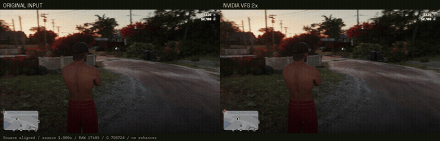

# FrameLab — česky

**Vývojové preview.19 (zatím zdrojové kódy):** vlastní OpenAI-compatible/Ollama server a volitelná paměť rozhovoru. Vybraný model sám vybírá původní repliky na pozadí. Výchozí stav je vypnuto a některé překlady může zhoršit. [Pilot přes skutečné OCR a zobrazení](https://opicebot.cz/framelab/runs/2026-11-24-context-memory/live.html?lang=cs) · [Metoda a omezení](CONTEXT-LIVE-VALIDATION.md) · [Návod k serveru](https://opicebot.cz/framelab/guide/custom-ai.html). Veřejný ZIP zůstává preview.18; plánovaných 25 českých a 50 vícejazyčných kontextových ukázek ještě hotových není.

**Preview.17:** RIFE / DirectML i pro vhodné GPU jiných výrobců, opravený Optical Flow, 40 jazykových voleb a stažení TranslateGemma v aplikaci. [GPU a nastavení](GPU-BACKENDS.md) · [Vícejazyčné titulky](MULTILINGUAL.md) · [Výsledky](release-preview17.md).

Obraz ze střihovky nebo videa → GPU → monitor. Generování snímků, volitelný enhancer a lokální vícejazyčné titulky.

**[Stáhnout preview.18](https://github.com/tomik520i/FrameLab/releases/download/v0.2.0-preview.18/FrameLab-0.2.0-preview.18-windows-x64-full.zip) · [Web a ukázky](https://opicebot.cz/framelab/?lang=cs) · [English](../README.md)**

[Obrazový návod — skutečné screenshoty krok za krokem](https://opicebot.cz/framelab/guide/visual.html)

[Změny preview.17 (EN)](release-preview17.md) · [Úplné hodnocení 1 747 překladů](https://opicebot.cz/framelab/runs/2026-11-20-3h/?lang=cs)

## Co umí

- FG 2× / 3× / 4× přes NVIDIA VFG, RIFE 4.22 lite / DirectML nebo samostatný Optical Flow. Začněte na 2×; vyšší násobiče mohou dělat výrazné artefakty.
- Volitelný NR enhancer: porovnání stejného snímku před/po, síla, limit rozlišení a 1–4 průchody.
- Vícejazyčné titulky: 40 jazykových voleb, 12 přibalených OCR sad a volitelná TranslateGemma. CPU OPUS a CUNI Q3/Q5/Q8 zůstávají pro EN → CS. Označte slovo, oblast čtení a uložte pojmenovaný profil.
- Vlastní MP4/MKV, výběr zvuku a titulkové stopy, samostatné FPS a rozlišení střihovky.
- Nahrávání vstupu, FG, před/po enhancu a výsledku s titulky; klipy, SRT, ID a nastavení JSON.
- Debug až do vypnutí: FPS, CPU/GPU, fronty, OCR, překlad a změny nastavení. Fullscreen, audio výstupy a EN/CZ.

## Spuštění

Rozbalte celý ZIP a spusťte **Start FrameLab.cmd** nebo **1 - Spustit FrameLab.cmd**. Nová instalace pustí GTA ukázku, další spuštění obnoví relaci. V Capture vyberte kartu nebo vlastní video, začněte s FG 2×. Celá obrazovka: F11.

**[Kompletní český návod](../INSTALL.cs.md) · [Obrázkový návod](https://opicebot.cz/framelab/guide/)**

V balíčku jsou VFG i RIFE runtime a modely, OCR, CPU překladač, kodeky a export; není nutný Python ani SDK. GPU model se stáhne přímo v aplikaci. Externí NR DLL nejsou přibalené ani zrcadlené, protože oprávnění k jejich distribuci nebylo doloženo. [Průvodce importem a odkazy](enhancer-install.cs.md).

## Výsledky bez přikrášlení

[Nová GTA sada](../examples/2026-11-20/README.md) obsahuje parametry, ID snímků, nativní výřezy, videa, SRT a očištěný debug. U 2× jsme zkontrolovali **437 párů A / generovaný / B**; žádný generovaný snímek nebyl kopií kraje. To dokazuje rozdílné pixely, nikoli bezchybný pohyb.

Záznam má **29,33 změněných vstupů/s**, **29,20 generovaných/s** a **52,07 různých snímků/s odeslaných aplikací**. Není to důkaz stabilních 60 FPS na panelu. Čítače neměří fyzický monitor ani celou odezvu od ovladače.

Dva enhancer záznamy používají 1440p, jeden průchod, 100 %, odhad pohybu zapnutý. Druhý má jen **12,28 s** úplných dat. Tři titulkové ukázky mají **6,61 / 3,70 / 3,46 s**; chyby překladů zůstaly původní. Nová verze opravuje příliš krátký timeout čtení GPU. Délku dál omezuje RAM a volný disk.

Sestava: RTX 5070 Ti 16 GB, Ryzen 9 5900X, 64 GB RAM, Windows 11 Pro, AVerMedia GC573, monitor 1440p/165 Hz, ovladač 617.14. Ve smíšené dvacetiminutové relaci: medián OCR **333 ms**, příjem obrazu → český titulek **958 ms**, NR worker **5,83 ms**. Časy se překrývají; relace zahrnuje nastavování i export.

Při stejném opakovaném vstupu s FG 2× + NR vyšlo **53,81 FPS v popředí, 52,93 za maximalizovaným oknem a 54,82 fullscreen**. Výrazný propad se nezopakoval. Titulky byly při izolovaném testu vypnuté. Výchozí systémové časování se nemění.

## Podpora

**[Podpořit přes Opicebot](https://opicebot.cz/?public=prdelniopice&donation2=prdelniopice)** — pouze česká stránka, PayPal v CZK.

Zdrojový kód GPL-3.0; knihovny a herní záběry mají vlastní podmínky. Komunitní projekt bez spojení s NVIDIA a vydavateli her.

## Nové v preview.18: okno hry, samostatné titulky a Vulkan

- **Vstup → Okno aplikace:** obnov seznam, vyber běžící hru nebo Remote Play a spusť zachytávání. Hra musí zůstat otevřená; začni režimem okna nebo bezrámečkového okna. Chráněný obraz a některé hry zachytit nejdou. Obrazovou GPU vybereš samostatně; při změně se aplikace restartuje.
- **Zobrazení → Jen titulky přes zdrojové okno:** průhledný překryv sleduje vybrané okno, kliknutí propouští do hry. OCR oblast nastav předem a polohu českého textu posuň nezávisle. Tento režim nepřidává FG ani NR do samotné hry. [Obrazový postup Remote Play, překryvu a API](docs/remote-subtitles-api.cs.md).
- **Titulky → Výpočet překladu:** Automaticky, CUDA, Vulkan nebo CPU; vyber i konkrétní GPU. CUNI a Gemma používají stejné modely. Pro nedostatek VRAM lze povolit GPU + RAM. Na tomto notebooku je nejlepší CUDA; Intel UHD / Vulkan funguje, ale je pomalý. AMD nebylo fyzicky otestováno. [Návod a časy](docs/local-translation-compute.cs.md).
- **Volitelné OpenAI API:** zvol online způsob překladu, vlož vlastní klíč a načti modely. Klíč ukládá Windows Credential Manager; do API odchází text OCR. Výchozí nabídka míří na levné rychlé modely, podporované parametry řídí profily. Bez klíče fungují místní překladače. Placené hodnocení kvality se v aplikaci nespouští.
- Přibalený místní filtr omezuje jména, SPZ a nápisy; nejednoznačnou větu neumí vždy odlišit od titulku. Zúžení OCR oblasti zůstává důležité. Aktivní přehrávání/zachytávání brání uspání displeje; nejde o trvalou změnu nastavení Windows.

[Vlastní hodnocení všech 2 000 překladů, pořadí modelů a konkrétní chyby](https://opicebot.cz/framelab/runs/2026-11-23-direct-review/). Sada 500 replik měřila textový překlad bez FG, enhanceru a OCR; není to měření herních FPS.
