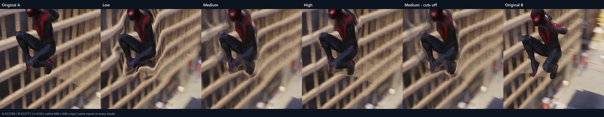
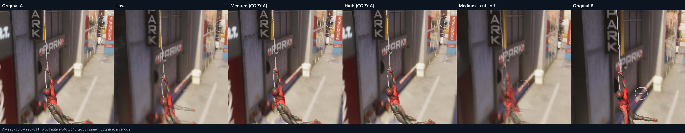

# Ladění 3× a 4× na původních nahrávkách

[English / úplná metodika](vfg-tuning.md) · [Výsledky JSON](performance/vfg-tuning-2026-11-18/summary.json) · [Testovací sestava](test-system.cs.md)

Upravená smyčka obsluhuje hotové GPU výpočty i během čekání na monitor a zbytečně nepřekresluje stejný obraz. Ve třech opakováních stejného 1440p záznamu se **4× Medium posunulo z 121,1 na 126,7 odeslaných ID/s**, odezva aplikace z 43,7 na 42,4 ms. Je to menší optimalizace plánování; samotné artefakty modelu neopravuje.

V nastavení 3×/4× jsou tlačítka **Vyvážené 3x** (Medium) a **Rychlé 4x** (Low). Obě zapnou generování a automatickou detekci střihu. Výchozí 2× Medium zůstává. Změny jsou součástí preview.7. [Stáhnout úplný report, video a plné snímky](https://github.com/tomik520i/FrameLab/releases/download/v0.2.0-preview.7/FrameLab-vfg-tuning-2026-11-18.zip).

| Nastavení | Původní ID/s → nové ID/s | Odezva původní → nová | Celá GPU, nově |
| --- | ---: | ---: | ---: |
| 3× Medium | 112,5 → **113,7** | 37,0 → **36,5 ms** | 41,5 % |
| 4× Medium | 121,1 → **126,7** | 43,7 → **42,4 ms** | 43,5 % |
| 3× Low | 116,9 → **117,7** | 33,2 → **32,6 ms** | 30,7 % |
| 4× Low | 142,1 → **146,7** | 36,0 → **34,6 ms** | 30,4 % |

Medium má tři čisté běhy pro každou variantu, Low pouze jeden. Stejný úsek nahrávky 84744531 (9,5–12,5 s) se opakoval s původními rozestupy příchodů. Každý běh trval 20 s, prvních 5 s je vynecháno. Monitor 165 Hz, VSync vypnutý, deduplikace a porovnání zapnuté. Při zahrnutých měřeních neběžel záznam ani export. Jedno opakování, které se překrylo s exportem PNG, je výslovně vyřazeno.

**FPS jsou odeslaná ID a ID pozorovaná Windows, nikoli kamerou ověřené FPS panelu či počet rozdílných obrazů.** Odezva začíná přijetím pixelů a končí Present; neobsahuje zdroj, střihovku a monitor. Vytížení zahrnuje celou kartu a ostatní otevřené programy včetně Avastu. Vyšší výkon Fast 4x zahrnuje přepnutí kvality na Low, není to jen zásluha optimalizace kódu.

V samostatných dvou 20sekundových bězích **se zapnutým VSync** se 4× Medium zlepšilo z **90–97 na 126 ID/s**, odezva z **50–53 na 44 ms**. Při vyšším počtu výpočtů zde vzrostlo celkové vytížení GPU přibližně z 41 na 51 %. Pořadí staré/nové varianty bylo ve druhém opakování obrácené. Výsledky jsou [uložené odděleně](performance/vfg-tuning-2026-11-18/validation). Samostatná kontrola 2× bez VSync ukázala prakticky stejnou rychlost 77,8 → 77,7 ID/s.

Na tomto vybraném problematickém místě má Low čistší nohy než Medium. [Plný výřez 1:1](images/vfg-quality-modes-native.png). High mění podobu chyb, ale záběr úplně neopraví. Jinde Low zhorší detaily.

Tady Medium a High vracejí **přesnou kopii A**. Vypadají ostře, ale nejedná se o správný mezisnímek. Vypnutí detekce střihu přidá výrazné duchy. Proto detekce zůstává zapnutá.

Celkem proběhlo **28 offline porovnání** nastavení. Na původním 1080p60 CS:GO videu byly některé skutečné snímky vynechány a použity jako reference pro PSNR. Medium mělo v průměru lepší výsledek než Low; High s detekcí střihu bylo pomalejší a v průměru horší než Medium. Při vypnuté detekci High v testu 3× Medium překoná jen nepatrně. Test 3× používá 20fps vstup, 4× používá 15fps vstup: srovnávat lze nastavení uvnitř stejného násobiče. U PS5 nemáme správně časovaný referenční mezisnímek, proto zde není vymyšlené skóre kvality.

Místní report v `analysis-output/vfg-tuning-report-2026-11-18/index.html` obsahuje 12sekundové video (3 s pohybu zpomalené 4×), šest porovnávacích výřezů, 36 plných PNG a JSON/CSV s nastavením, ID a kontrolními součty. Video je zarovnané podle času zdroje, takže nezobrazuje odezvu. Při exportu se pouze používají již vypočtené snímky, nevytváří se další interpolace. Kopie jsou označené COPY A/B.

[Kompletní tabulka odezvy](performance/vfg-tuning-2026-11-18/replay-table.md) · [Kvalita a GPU čas](performance/vfg-tuning-2026-11-18/quality-table.md) · [Postup reprodukce a omezení](vfg-tuning.md#reproduce)
