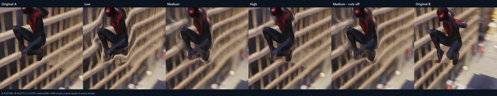
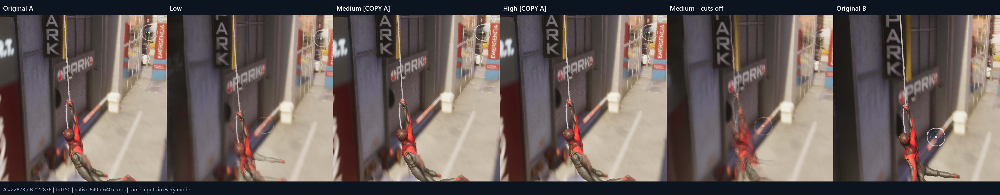

# Recorded-input tuning of 3× and 4×

[Česky](vfg-tuning.cs.md) · [Machine-readable results](performance/vfg-tuning-2026-11-18/summary.json) · [Test system](test-system.md)

**The output loop now avoids redundant redraws and services completed GPU work while presentation is waiting.** On the same recorded 1440p input, Medium 4× improved from 121.1 to 126.7 submitted image IDs/s; average application latency changed from 43.7 to 42.4 ms. This is a modest scheduling improvement, not a repair of the model's image artifacts.

Two shortcuts are available beside the 3×/4× settings: **Balanced 3x** selects Medium and **Fast 4x** selects Low. Both enable generation and automatic scene-cut detection. Manual Low/Medium/High settings remain available. The default remains Medium 2×.

These changes are included in preview.7. The earlier preview.6 download predates them. [Download the complete tuning report, video and full-resolution frames](https://github.com/tomik520i/FrameLab/releases/download/v0.2.0-preview.7/FrameLab-vfg-tuning-2026-11-18.zip).

## Same recorded input, actual application output

RTX 5070 Ti / Ryzen 9 5900X / driver 617.14. Original 2560×1440 RAW frames from recording **84744531**, source time **9.5–12.5 seconds**, replayed repeatedly with their recorded arrival spacing. No capture device, analysis recording or video export is active during the included measurements. VSync is off, the monitor mode is 165 Hz, deduplication and the comparison panel are on.

| Setting | Previous loop: IDs/s / latency | New loop: IDs/s / latency | Whole GPU, new loop |
| --- | ---: | ---: | ---: |
| 3× Medium | 112.5 / 37.0 ms | **113.7 / 36.5 ms** | 41.5% |
| 4× Medium | 121.1 / 43.7 ms | **126.7 / 42.4 ms** | 43.5% |
| 3× Low | 116.9 / 33.2 ms | **117.7 / 32.6 ms** | 30.7% |
| 4× Low | 142.1 / 36.0 ms | **146.7 / 34.6 ms** | 30.4% |

Medium aggregates contain three clean runs per condition; Low has one run per condition. Each run lasts 20 seconds and excludes the first five seconds. [All measurements, ranges and limitations](performance/vfg-tuning-2026-11-18/summary.json), [full table](performance/vfg-tuning-2026-11-18/replay-table.md), and [per-run CSVs](performance/vfg-tuning-2026-11-18/replay) are retained. Repeat 1 of the repeated Medium experiment overlapped a CPU PNG export and is excluded, as recorded in the aggregate JSON.

The previous/new comparison uses the same candidate binary with `--legacy-output-wait` to restore the old scheduling behavior. The change reduces redundant Present calls from roughly 294/s to 127/s at Medium 4×. UI-only updates remain available at 60 Hz. Input and output queues remain bounded; overload still drops work.

**Separate VSync-on validation:** two additional 20-second Medium 4× runs per condition, with order reversed on the second repeat, improved from **90.0–97.1 to 126.4–126.7 submitted IDs/s**. Latency changed from **50.0–53.0 to 43.7–43.8 ms**. Whole-GPU utilization increased from about 41% to 51% as more useful frames were processed. OS-observed IDs/s were 77.0–80.1 before and 126.4–126.7 after; these remain conservative sampled confirmations. A separate 16-second 2× check without VSync remained effectively unchanged at 77.8 → 77.7 IDs/s. These validation runs are kept [separately](performance/vfg-tuning-2026-11-18/validation), not pooled into the VSync-off table.

**These are submitted and OS-observed image IDs, not physical panel FPS or a count of distinct pixel images.** Windows-observed ID rates matched the submitted averages in these runs. The model can return an exact original under a fresh ID. Latency is callback → Present, excluding the source, capture card and display. GPU utilization belongs to the whole device, including normal background applications and Avast.

## Image quality: Low can help, but it is not universally better

The native [full comparison](images/vfg-quality-modes-native.png) uses A #22768 and B #22771, a 58.03 ms gap, at t=0.5. Medium produces strong doubled limbs; Low looks cleaner around the legs in this selected failure case. High changes the failure pattern but does not remove all distortion. All generated results in this example differ from both input images.

The second example, A #22873 → B #22876, illustrates the tradeoff. Medium and High return **exact copies of A** at t=0.5. Their sharp appearance is not successful interpolation. Disabling automatic cut detection creates an intermediate but introduces conspicuous ghosts. Low also distorts the moving character. Automatic cuts therefore remain enabled by default.

An additional local report contains six phase sheets, 36 full-resolution lossless PNGs, settings/ID/hash metadata, and a 12-second video showing three seconds of motion at 4× slowdown. The video uses the same 67 original processed A/B pairs for Low, Medium and High. It is source-time aligned, so latency is intentionally excluded. It only holds/resizes existing pixels; export performs no new interpolation. Endpoint copies are labelled `COPY A/B`.

Run `tools/export_vfg_quality.py` to reproduce those visual assets. They are saved under `analysis-output/vfg-tuning-report-2026-11-18`, separate from the historical release examples.

## Controlled check against real withheld frames

Twenty-eight offline runs cover Low/Medium/High, automatic cuts on/off, and 3×/4×, plus Medium baselines. Each setting within a multiplier receives identical input pixels. The CS:GO 1080p60 sample supplies real held-out intermediate frames: 3× uses 20 FPS input and 4× uses 15 FPS input. **Do not treat cross-multiplier differences as a controlled 30 FPS comparison.**

| Test, cuts on | Low PSNR | Medium PSNR | High PSNR | Medium pair time | High pair time |
| --- | ---: | ---: | ---: | ---: | ---: |
| 3× / 158 withheld frames | 28.700 dB | **29.200 dB** | 29.020 dB | 8.51 ms | 29.13 ms |
| 4× / 177 withheld frames | 27.528 dB | **27.891 dB** | 27.732 dB | 11.50 ms | 41.21 ms |

[All quality/cut results](performance/vfg-tuning-2026-11-18/quality-table.md). Pair time includes input uploads, dispatch and completion of all intermediate phases; excludes disk, readback, scoring, display and source delay. Four warmup pairs are excluded. PSNR measures full RGB error, not perceptual perfection. Each per-frame CSV also includes hold-A and linear-blend baselines.

High without cuts narrowly exceeds Medium for 3× in this sample (29.216 vs 29.200 dB), but is much slower. Medium without cuts reaches 27.975 dB at 4×. This small aggregate gain is insufficient to justify disabling scene-change protection globally. The recorded PS5 gameplay has no correctly timed intermediate ground truth; no PSNR quality claim is made for it.

SDK input binding was corrected to match [NVIDIA's official per-pair example](https://github.com/NVIDIA-Maxine/VFX-SDK-Samples/blob/52011f89c1741d06b40ea312af1f20be8be9ec62/apps/VideoFrameGenerationEffectApp/VideoFrameGenerationEffectApp.cpp#L674). **All 430 compared outputs were RGB-identical before/after this correction**, with no material measured speed improvement. It is not presented as an artifact fix.

## Reproduce

1. Build normal dependencies as described in the [build guide](../README.md#build), then configure `cmake -S . -B build -DFRAMELAB_OUTPUT_NAME=FrameLab-next -DFRAMELAB_BUILD_OFFLINE_BENCHMARK=ON` and build Release. The benchmark requires the same separately installed NVIDIA runtime as the app.
2. Keep `app/samples/csgo-1080p60.bgra` and the original `app/recordings/analysis-15s-84744531/{frames.csv,raw.bgra}`. These multi-gigabyte originals are local test inputs, not included in the repository. The CS:GO source/preparation is documented by `tools/prepare_sample.py`.
3. Run `python tools/sweep_vfg.py --out analysis-output/vfg-sweep-2026-11-18 --stage sweep`. Offline executables create no window and capture no screen. Each completed run is preserved. Use a fresh directory for a new experiment.
4. Run `python tools/benchmark_replay.py --out analysis-output/your-new-replay --seconds 20 --repeats 3`. This opens the app and replays original pixels through its real presentation loop; leave the window unminimized. No HDMI capture is started. Do not run GPU/CPU-heavy exports simultaneously.
5. After timings finish, run `python tools/sweep_vfg.py --out analysis-output/vfg-sweep-2026-11-18 --stage quality-clips`, followed by `python tools/export_vfg_quality.py --sweep analysis-output/vfg-sweep-2026-11-18 --out analysis-output/vfg-tuning-report-2026-11-18`.

The standalone `FrameLab-benchmark` accepts a BGRA file and a CSV of A/B/truth byte offsets, so the method can be reused on other saved videos. `FrameLab-benchmark-legacy` retains the old SDK binding only as a measurement baseline. `tools/report_vfg_tuning.py` collects this dated experiment and explicitly records excluded runs.
