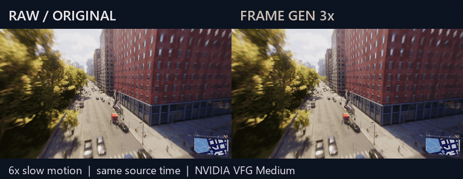
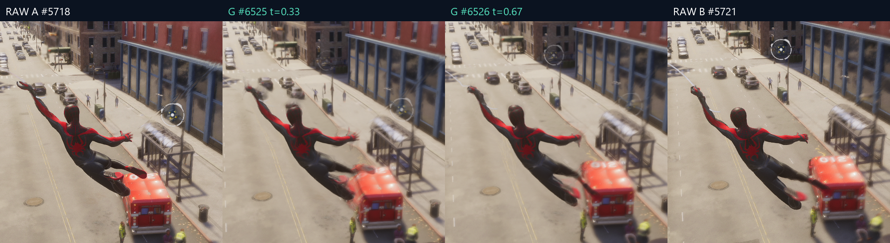
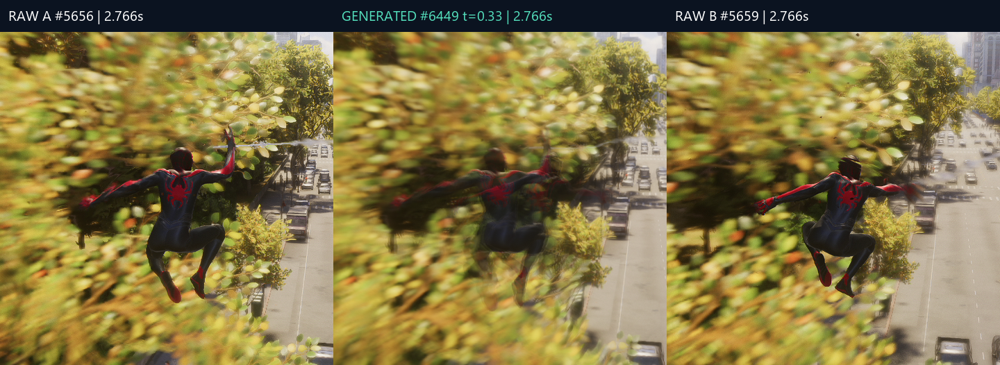
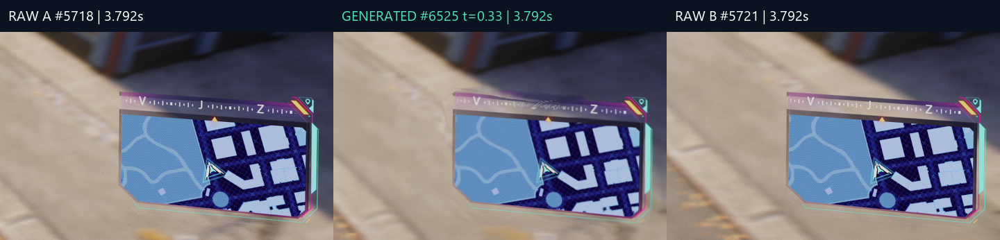

# 3×: více snímků, ale i viditelné artefakty

[English](README.md) · [FrameLab česky](../../docs/README.cs.md) · [Kontrolované ladění](../../docs/vfg-tuning.cs.md)

**Tento záznam prokazuje snímky navíc, ne bezchybný obraz.** Ze 40 změn vstupního obrazu/s aplikace odeslala 110,8 ID/s. Po započtení pouze změn známých RGB pixelů zůstává 105,6 změny/s. Nejde o fyzicky změřené FPS monitoru ani skóre kvality.

[Stáhnout celé porovnání](https://github.com/tomik520i/FrameLab/releases/download/v0.2.0-preview.7/FrameLab-112947656-comparison-example.zip), rozbalit a otevřít **index.html**. Obsahuje čtyři videa, plné PNG, nativní výřezy postavy/HUD, obě generované fáze, nastavení, ID snímků a kontrolní součty.

GIF: úsek **3,1–4,1 s**, zpomalení 6×, snímky zarovnané podle času zdroje. Zachovává všech 110 ID z vybraného úseku rekonstruovaného videa: 38 RAW a 72 generovaných. Při exportu se další snímky nedopočítávají. GIF zmenšuje detaily a barevnost, proto artefakty posuzujte z PNG. Nezobrazuje odezvu.

[Plné zpomalené MP4](https://github.com/tomik520i/FrameLab/releases/download/v0.2.0-preview.7/analysis-15s-112947656_source-aligned_3s_4x-slow.mp4) ukazuje úsek **2–5 s** zpomalený 4× na 12 s. ZIP obsahuje i variantu podle skutečných časů odeslání, která ponechává zpoždění. Rekonstrukce podle zdroje může zahrnovat i původní snímky přeskočené generátorem. Patnáctisekundové náhledy jsou převzorkované na 60 FPS.

## Dvě skutečné generované fáze

A #5718 → **G #6525 v 1/3** → **G #6526 ve 2/3** → B #5721. Rozestup vstupů 49,66 ms. Oba mezisnímky se liší od obou originálů.

Pohyb pokračuje, ale nohy a hrany sanitky se rozmazávají a získávají další obrysy. U průletu listím je chyba výraznější — postava zprůhlední a zdvojí se:

Také drobné značky kompasu nad minimapou se v generovaném snímku zvlní:

G #6559 je přesná kopie A a G #6560 přesná kopie B, ověřeno přes všechny RGB pixely. Nové ID tedy samo o sobě neznamená novou polohu pohybu. Automatický fallback detekce střihu je možné vysvětlení, konkrétní důvod ale nebyl zaznamenán.

## Naměřeno z celých 15 sekund

| Položka | Výsledek |
| --- | --- |
| ID záznamu / nastavení | `analysis-15s-112947656` / `analysis-15s-112947656_settings` |
| Rozlišení / vstup | **1920×1080**, 900 RAW = 60/s |
| Zařízení / GPU | AVerMedia GC573 / RTX 5070 Ti |
| Nastavení | NVIDIA VFG Medium 3×, detekce střihu a deduplikace zapnuté, VSync vypnutý |
| Plánování výstupu | Verze 3, nezávislá obsluha GPU |
| Měnící se vstupy | 600 = 40/s; 300 duplicitních zachycení |
| Uložené generované snímky | 1106 z 553 párů včetně hranic záznamu |
| Porovnatelné snímky | 1102; čtyři mají vstupy před začátkem záznamu |
| Jiné než oba vstupy | 1028 / 1102 = 93,28 % — **není skóre přesnosti** |
| Přesné kopie | 74: 45× A, 29× B |
| Odeslaná a Windows pozorovaná ID | **110,80/s** |
| Změny známých RGB obrazů | **105,60/s** |
| Interval odeslání ID | Průměr 9,03 ms; p95 13,50 ms; maximum 17,62 ms |
| RAW přijetí → odeslání RAW | Průměr **48,96 ms**, p95 64,25 ms |
| Přijetí B → odeslání generovaného | Průměr **35,31 ms**, p95 51,97 ms |
| Ztráty rekordéru / chyby pořadí | **0 / 0**; všechny uložené generované snímky byly odeslány |
| Bezztrátová RAM komprese | 16,64 GB původních pixelů → 10,62 GB uložených bloků |

Násobič se týká zpracovaných párů. Ve skutečnosti zde není 40×3 = 120 výstupních ID/s. Nulové ztráty rekordéru neznamenají, že generátor zpracoval každý vstup. Nahrávání a komprese mohou výkon ovlivnit.

Odezva nezahrnuje hru, střihovku a monitor. Čas generovaných snímků začíná u novějšího vstupu B. Windows potvrzení jsou vzorkovaná ID, nikoli kamerové měření panelu. V tomto záznamu nebyla uložena časová řada GPU vytížení. Samostatná 1440p měření v dokumentaci nejsou měřením tohoto 1080p záznamu.

Starší 2× a 4× ukázky jsou v **1440p**, s jiným pohybem a starší verzí plánování. Nelze z nich udělat férové přímé pořadí kvality či výkonu proti této 1080p ukázce. Artefakty 3× jsou stále výrazné zejména v listí, kolem siluety a na drobných prvcích HUD.

[Úplná metodika a postup reprodukce](README.md#reproduce). Záznam hry zůstává pod právy příslušných vlastníků; GPL licence aplikace nelicencuje herní obsah.
