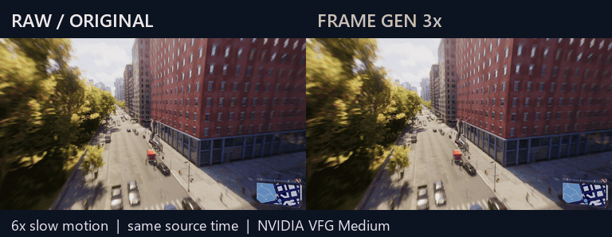
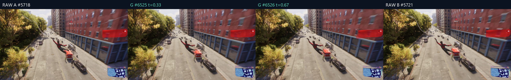
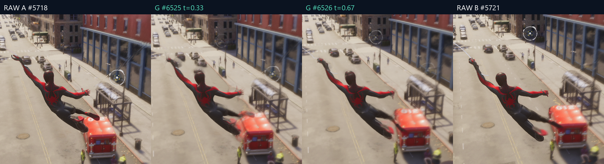
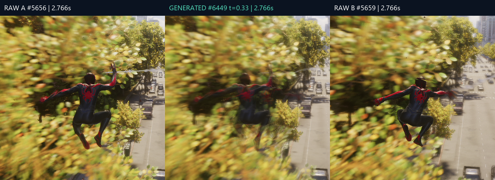
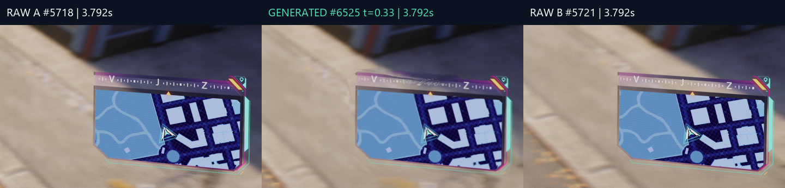
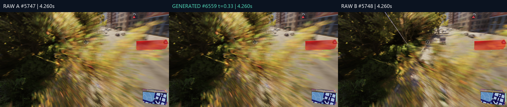

# 3× gameplay: 1080p capture, extra frames and visible artifacts

[Česky](README.cs.md) · [FrameLab](../../README.md) · [Controlled tuning tests](../../docs/vfg-tuning.md)

**The new 3× recording contains real additional image positions, but also clear interpolation failures.** The captured content changes 40 times/s. The application submits 110.8 image IDs/s; after removing consecutive equal RGB images, 105.6 known image changes/s remain. These are recorded application/Windows observations, not a physical monitor measurement or a quality score.

[Download the complete comparison package](https://github.com/tomik520i/FrameLab/releases/download/v0.2.0-preview.7/FrameLab-112947656-comparison-example.zip), extract it and open **index.html**. It includes four videos, full-resolution PNGs, native character/HUD crops, both generated phases, original settings, per-frame ID maps and checksums.

## Original versus 3×, slowed down



The GIF uses source time **3.1–4.1 s**, slowed 6×. It retains all 110 output-image IDs appearing in the selected source-aligned movie interval (38 RAW and 72 generated). It is reduced to 768×298 and a GIF palette. Processing delay is removed; it does not show input lag. No new interpolation is performed during GIF export. [GIF settings and frame map](../../docs/images/framelab-3x-slow-comparison.json).

[Full slow-motion MP4](https://github.com/tomik520i/FrameLab/releases/download/v0.2.0-preview.7/analysis-15s-112947656_source-aligned_3s_4x-slow.mp4): source time **2–5 s**, slowed 4× to 12 seconds. The ZIP also contains the same segment with **actual submission timing**, retaining processing/queue delay. Source-aligned reconstruction can include captured originals skipped by the generator. The two full 15-second previews are resampled to 60 FPS and cannot show every ~111/s submission at real speed.

## Both intermediate phases of one source pair

**A #5718 → G #6525 at t=1/3 → G #6526 at t=2/3 → B #5721**, with a 49.66 ms source gap. The two generated frames differ from both originals.





The positions advance, but the feet and the ambulance roof smear and develop extra contours. Some motion blur is already present in the originals; the generated silhouette and edge distortions are additional.

## Include the failures

At **G #6449**, A #5656 → B #5659, the character crosses foreground leaves. The generated torso/arms become translucent and double against the background:



HUD text also suffers: G #6525 warps the small compass ticks above the minimap. The endpoints keep a more regular line:



**G #6559 is exactly A and G #6560 is exactly B**, from the same A #5747 → B #5748 pair. Equality is checked over every RGB pixel. Such frames get new IDs but do not add new intermediate positions. A cut-detection fallback is possible; its reason was not logged.



## Complete recording measurements

| Parameter | Recorded value |
| --- | --- |
| Recording / settings ID | `analysis-15s-112947656` / `analysis-15s-112947656_settings` |
| Duration / recorder losses | 15 seconds complete / 0 |
| Capture device / source | AVerMedia HD Capture GC573 1 / PS5 gameplay |
| Delivered pixels | **1920×1080 BGRA8**, 900 frames = 60 callbacks/s |
| GPU / backend / quality | RTX 5070 Ti / NVIDIA VFG / Medium |
| Multiplier / cut detection / dedup / VSync | 3× / on / on / off |
| Scheduler | Pacing version 3, `independent-gpu-pump-content-deadline` |
| Changing input images | 600 = 40/s; 300 adjacent duplicate captures |
| Saved generated images | 1106 from 553 A/B pairs including boundaries (~36.87 pairs/s) |
| Comparable generated images | 1102; 4 have source endpoints outside the recording window |
| Different from both endpoints | 1028 / 1102 = 93.28%; **not interpolation accuracy** |
| Exact endpoint copies | 74: 45 equal A and 29 equal B |
| Submitted image-ID changes | 1662 = **110.80/s** |
| Known submitted RGB changes | 1584 = **105.60/s**; unknown boundary images excluded |
| Windows-observed image-ID changes | 1662 = 110.80/s; 1108 generated IDs include boundary images |
| Known RGB changes among Windows-observed IDs | 1584 = 105.60/s |
| Submission-ID interval | Mean 9.03 ms; p95 13.50 ms; max 17.62 ms |
| A/B source gap | Mean 27.07 ms; p95 49.66 ms; max 50.68 ms |
| RAW callback → RAW submission | Mean **48.96 ms**, p95 64.25 ms |
| B callback → generated submission | Mean **35.31 ms**, p95 51.97 ms |
| G-phase → B ordering anomalies | 0; all saved generated IDs were submitted |
| Lossless RAM storage | 16.64 GB raw pixels → 10.62 GB compressed; 10.62 GB peak |

The 3× multiplier applies to **processed pairs**, not every changing input. This take did not reach 40×3=120 output IDs/s. Zero recorder losses means admitted diagnostic frames reached disk; it does not prove no input frames were skipped before interpolation. Readback/compression can affect throughput.

The capture dimensions describe what the driver delivered, not independently detected HDMI wire timing. Windows confirmations are sampled ID observations, not camera-verified scanout. Copied pixels can carry a fresh ID. Latency excludes game rendering, capture-card buffering and monitor scanout; generated latency is measured from newer endpoint B. GPU utilization/execution-time series were not stored in this take. See the [separate 1440p replay benchmarks](../../docs/vfg-tuning.md) for GPU/performance tests, not measurements of this 1080p recording.

## Compared with earlier examples

| Take | Resolution | Changing input/s | Submitted IDs/s | Known RGB changes/s |
| --- | --- | ---: | ---: | ---: |
| [2×: 82183953](../82183953/README.md) | 1440p | 40.00 | 80.00 | 79.00 |
| **3×: 112947656** | **1080p** | 40.00 | 110.80 | 105.60 |
| [4×: 84744531](../84744531/README.md) | 1440p | 39.73 | 87.87 | 83.80 |

**Different resolution, movement, application version and recording overhead: this is not a controlled multiplier ranking.** The new GIF demonstrates additional sampled positions, while the native crops show why more frames do not imply a clean image. There is no correctly timed missing-frame ground truth for this PS5 recording.

## Reproduce

With the original lossless recording retained locally:

```powershell
python tools/audit_analysis_take.py app/recordings/analysis-15s-112947656
python tools/build_comparison_materials.py app/recordings/analysis-15s-112947656 --start 2 --seconds 3 --slowdown 4 --sample-id 6449 --sample-id 6525 --sample-id 6526 --sample-id 6559 --sample-id 6560 --sample-id 7069
python tools/build_phase_strip.py app/recordings/analysis-15s-112947656 --generated-id 6525
python tools/build_readme_gif.py --recording-id 112947656 --source-start 3.1
python tools/finalize_comparison_release.py app/recordings/analysis-15s-112947656
```

The public ZIP excludes the multi-gigabyte lossless recordings while retaining their clip hashes and original byte-offset manifests. Game footage remains under its respective rights holders; the application's GPL license does not license game assets.
