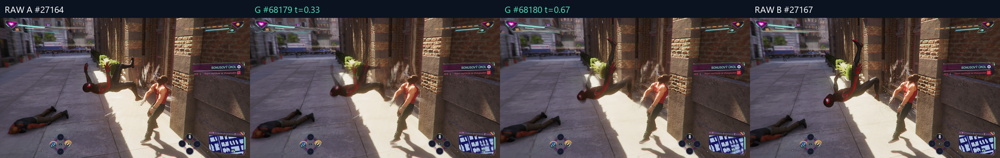
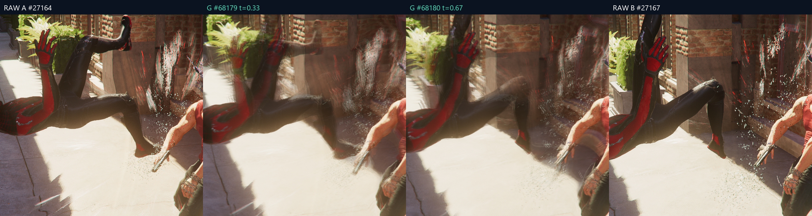
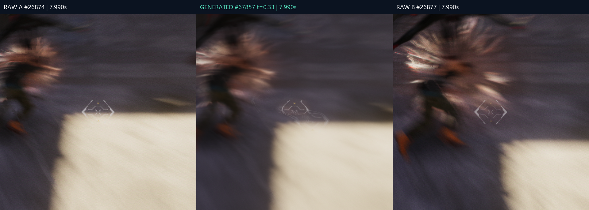
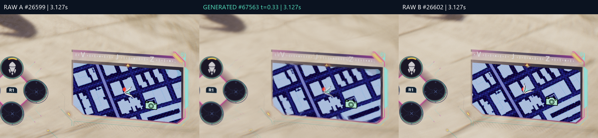
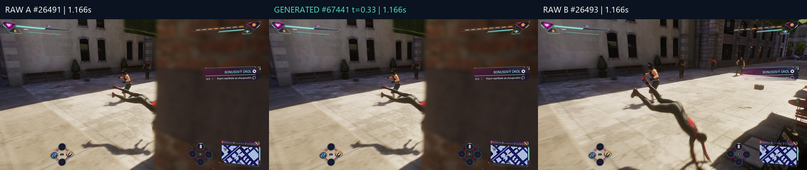

# Souboj ve 3×: 1440p, zapnutý VSync a viditelné chyby

[English](README.md) · [Český návod FrameLabu](../../docs/README.cs.md)

**Dopočet přidává skutečně odlišné obrazy, ale při rychlém souboji viditelně chybuje.** Za 15 sekund se vstup měnil **39,8× za sekundu**, aplikace odesílala **90,6 ID/s**, po vyřazení shodných sousedních obrazů zbývá **89,87 známých změn RGB/s**. Windows zaznamenal 90,6 ID/s a 89,8 známých změn RGB/s. Nejde o měření fyzického displeje kamerou.

[Stáhnout kompletní porovnání souboje](https://github.com/tomik520i/FrameLab/releases/download/v0.2.0-preview.7/FrameLab-113768562-comparison-example.zip). Po rozbalení otevřete **index.html**: čtyři videa, původní i generované PNG v plném rozlišení, výřezy postavy/HUDu, obě fáze dopočtu, nastavení, mapy ID a kontrolní součty.

## Tři sekundy akce zpomalené na dvanáct

[Zpomalené video originál proti 3×](https://github.com/tomik520i/FrameLab/releases/download/v0.2.0-preview.7/analysis-15s-113768562_source-aligned_3s_4x-slow.mp4) používá úsek **11,5–14,5 s**, zpomalený **4×**. Jsou v něm útoky zblízka a zásah u zdi. Časově zarovnaná varianta odstraňuje zpoždění zpracování a může zahrnovat i originály, které generátor přeskočil. V ZIPu je také varianta se **skutečným časováním odesílání**, která zpoždění zachovává. Export žádné nové snímky nedopočítává. Celé 15sekundové náhledy mají 60 FPS, takže v reálné rychlosti nezobrazí všech přibližně 91 odeslaných ID/s. Zvuk se nenahrával.

## Kop: obě fáze stejného páru

**A #27164 → G #68179 (t=1/3) → G #68180 (t=2/3) → B #27167**, rozestup zdrojů **48,09 ms**:

Poloha nohy postupuje, ale v mezisnímcích zůstává průsvitná zvednutá noha a vedle ní vzniká další obrys níž. Duchy přibývají i kolem pohybujícího se těla. Částice zásahu a část pohybového rozmazání jsou už v originálu; samotné tyto efekty nejsou důkaz chyby dopočtu.

Při prudkém výpadu **G #67857** jsou originály také hodně rozmazané. Středový zaměřovač má ale v původních snímcích zřetelnější tvar a v generovaném snímku se rozdvojí a zkroutí:

U **G #67563** se při otáčení minimapy rozmazávají a zdvojují drobné hrany. Okolní ikony zůstávají stabilnější:

Ukázky jsou vybrané podle pohybu a viditelných chyb, nejde o náhodný vzorek pro skóre kvality. Balíček obsahuje i další celé snímky, výřezy a G #68249 z konce souboje.

## Čísla za celý záznam

| Parametr | Hodnota |
| --- | --- |
| ID záznamu / nastavení | `analysis-15s-113768562` / `analysis-15s-113768562_settings` |
| Délka / ztráty recorderu | 15 sekund dokončeno / 0 |
| Karta / zdroj | AVerMedia HD Capture GC573 1 / PS5 |
| Přijaté rozlišení / snímky | **2560×1440 BGRA8 / 829 = 55,27/s** |
| GPU / backend / kvalita | RTX 5070 Ti / NVIDIA VFG / Medium |
| Násobič / detekce střihu / deduplikace / VSync | **3× / zapnuto / zapnuto / zapnuto** |
| Plánování výstupu | Pacing verze 3, `independent-gpu-pump-content-deadline` |
| Změny vstupu | 597 = **39,80/s**, 232 sousedních přesných kopií |
| Uložené generované snímky | 906, z 453 párů včetně okrajů (~30,2 párů/s) |
| Porovnatelné generované snímky | 902, další 4 mají zdroje mimo uložené časové okno |
| Odlišné od obou zdrojů | 894 / 902 = **99,11 %; nejde o přesnost dopočtu** |
| Přesné kopie zdrojů | 8, z toho 4× A a 4× B |
| Odeslané změny ID / známé změny RGB | **90,60/s / 89,87/s** |
| Windows: pozorované změny ID / známé změny RGB | **90,60/s / 89,80/s** |
| Interval odeslaných ID | Průměr 11,04 ms; p95 14,69 ms; maximum 24,65 ms |
| Rozestup zdrojů A/B | Průměr 33,12 ms; p95 52,93 ms; maximum 66,44 ms |
| RAW příjem → odeslání RAW | Průměr **64,16 ms**, p95 80,22 ms |
| Příjem B → odeslání generovaného snímku | Průměr **48,61 ms**, p95 66,47 ms |
| Chyby pořadí generované fáze → B | 0 |
| Konec záznamu | G #68282 je uložený, ale v okně záznamu nemá odeslání |
| Bezeztrátové uložení v RAM | 25,58 GB → 17,19 GB, špička 17,20 GB |

**G #67441 je přesná kopie A #26491 a G #67442 přesná kopie B #26493.** Ověřeno přes všechny RGB pixely. Nové ID tedy nemusí přidat novou polohu. Detekce střihu byla zapnutá, ale důvod těchto kopií se neukládal.

Násobič platí pro zpracované páry; výstup nedosáhl 39,8×3=119,4 ID/s. Nulové ztráty recorderu neznamenají nulové přeskakování vstupů před interpolací. Nahrávání zatěžuje přenosy z GPU a kompresi v RAM. Počáteční údaj vstupu byl 60,33/s, průměr celého záznamu je ale 55,27/s.

Latence začíná až přijetím snímku aplikací; nezahrnuje render hry, buffer střihovky ani zobrazení panelem. U generovaného snímku se počítá od novějšího zdroje B. Windows potvrzuje pozorovaná ID, nikoli fyzicky změřené změny panelu. U RGB počtů chybí neznámé obrazy za hranicí záznamu. Rozlišení je z přijatých pixelů, ne z nezávislého měření HDMI signálu. Tento záznam neobsahuje časovou řadu vytížení GPU; [samostatné testy](../../docs/vfg-tuning.cs.md) mají jiné podmínky.

## Proč jsou čísla jiná než u první nové 3× ukázky

[První záznam 112947656](https://github.com/tomik520i/FrameLab/blob/main/examples/112947656/README.cs.md) měl **1080p a vypnutý VSync**: 40 změn vstupu/s, 110,8 ID/s, 105,6 známých změn RGB/s, průměr RAW latence 48,96 ms. Souboj má **1440p a zapnutý VSync**: 39,8 → 90,6 ID/s, 89,87 změn RGB/s a 64,16 ms.

Liší se rozlišení, VSync, pohyb i zátěž při nahrávání. **Není to kontrolovaný test samotného souboje, rozlišení nebo VSync.** Méně kopií neznamená vyšší kvalitu: i pokřivený snímek se liší od obou zdrojů. Skutečné chybějící mezisnímky z PS5 neznáme, proto netvrdíme přesnost dopočtu. Postup reprodukce je v [anglickém přehledu](README.md).

Původní mnohagigabajtové bezeztrátové klipy zůstávají lokálně; veřejný balíček zachovává jejich hashe a indexy. Práva k hernímu obsahu zůstávají jeho vlastníkům, GPL aplikace se na něj nevztahuje.
