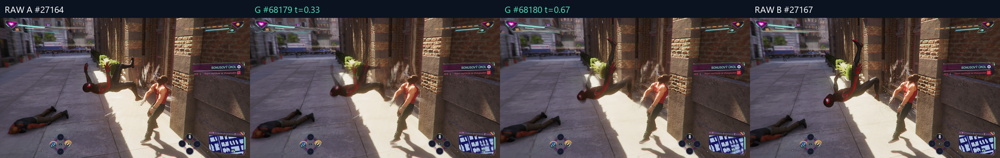
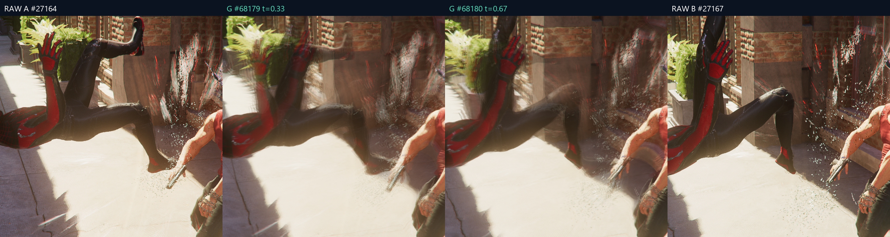
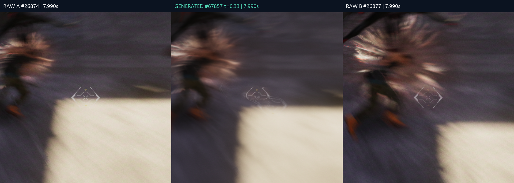
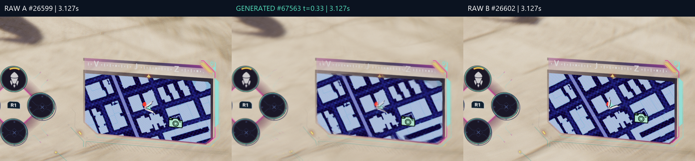
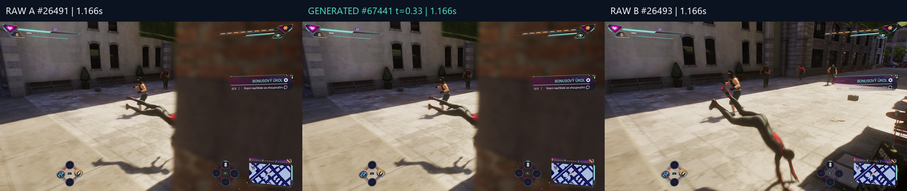

# 3× combat: 1440p, VSync on, extra positions and visible failures

[Česky](README.cs.md) · [FrameLab](../../README.md) · [1080p 3× take](https://github.com/tomik520i/FrameLab/tree/main/examples/112947656)

**Fast combat exposes interpolation errors even when nearly every generated image has new pixels.** In this 15-second recording the input changes **39.8 times/s**; the application submits **90.6 image IDs/s**, representing **89.87 known RGB changes/s**. Windows observations give 90.6 IDs/s and 89.8 known RGB changes/s. These are recorded software observations, not a physical monitor FPS measurement.

[Download the combat comparison package](https://github.com/tomik520i/FrameLab/releases/download/v0.2.0-preview.7/FrameLab-113768562-comparison-example.zip), extract it and open **index.html**. It contains four videos, full-resolution originals/generated PNGs, native character/HUD crops, both intermediate phases, settings, frame-ID maps and SHA-256 checksums.

## Three seconds of fighting, slowed to twelve

[Watch/download the slowed original-versus-3× MP4](https://github.com/tomik520i/FrameLab/releases/download/v0.2.0-preview.7/analysis-15s-113768562_source-aligned_3s_4x-slow.mp4).

The selected segment is **11.5–14.5 seconds**, slowed **4×**, covering close attacks and an impact against a wall. Its source-aligned timeline removes processing delay so positions can be compared; it can also include captured originals skipped by the generator. A second version in the ZIP preserves **actual submission timing**, including processing/queue delay. Both exports use only the recorded pixels, with equal resizing and no new interpolation. The two full 15-second previews are resampled to 60 FPS and cannot retain every ~91/s submission at real speed. No audio was recorded.

## Both phases of the kick

**A #27164 → G #68179 at t=1/3 → G #68180 at t=2/3 → B #27167**, source gap **48.09 ms**:





The leg advances, but the generated frames retain a translucent raised leg from an earlier position while drawing another lower leg. There are additional ghost contours around the moving body. The impact particles and some motion blur already exist in the originals; they are not all interpolation errors. These native crops make the extra silhouette failure visible without a GIF palette hiding detail.

## Fast lunge and HUD

At **G #67857**, A #26874 → B #26877, the original images already have strong motion blur. The central aiming reticle, however, has a clearer shape in both endpoints and becomes split/warped in the generated image:



At **G #67563**, the rotating minimap develops softened/doubled fine edges while surrounding icons remain more stable:



The package also includes G #67563's full scene and character crop, G #68249 near the end of the selected fight, and the failures below. Samples were chosen for motion and inspectable failure cases, not as a random quality sample.

## New IDs can contain old pixels

**G #67441 is exactly A #26491; G #67442 is exactly B #26493.** Equality was checked across every RGB pixel. There are eight such endpoint copies in the complete take, four A and four B. Automatic cut detection was enabled, but the reason for each copy was not logged, so it cannot be attributed to the detector with certainty.



## Complete recording measurements

| Parameter | Recorded value |
| --- | --- |
| Recording / settings ID | `analysis-15s-113768562` / `analysis-15s-113768562_settings` |
| Duration / recorder losses | 15 seconds complete / 0 |
| Device / source | AVerMedia HD Capture GC573 1 / PS5 gameplay |
| Delivered pixels / callbacks | **2560×1440 BGRA8** / 829 = **55.27/s** |
| GPU / backend / quality | RTX 5070 Ti / NVIDIA VFG / Medium |
| Multiplier / cuts / dedup / VSync | **3× / on / on / on** |
| Scheduler | Pacing version 3, `independent-gpu-pump-content-deadline` |
| Changing input images | 597 = **39.80/s**; 232 adjacent exact repeats |
| Saved generated images | 906 from 453 A/B pairs including boundaries (~30.2 pairs/s) |
| Comparable generated images | 902; four reference source endpoints outside the window |
| Different from both endpoints | 894 / 902 = **99.11%; not an accuracy score** |
| Exact endpoint copies | 8 = 4 A + 4 B |
| Submitted image-ID changes | 1359 = **90.60/s** |
| Known submitted RGB changes | 1348 = **89.87/s** |
| Windows-observed ID changes | 1359 = **90.60/s** |
| Known RGB changes among Windows-observed IDs | 1347 = **89.80/s** |
| Submission-ID interval | Mean 11.04 ms; p95 14.69 ms; max 24.65 ms |
| A/B source gap | Mean 33.12 ms; p95 52.93 ms; max 66.44 ms |
| RAW callback → RAW submission | Mean **64.16 ms**; p95 80.22 ms |
| B callback → generated submission | Mean **48.61 ms**; p95 66.47 ms |
| G-phase → B ordering anomalies | 0 |
| End boundary | G #68282 was saved but has no submission inside the recorded window |
| Lossless RAM storage | 25.58 GB raw pixels → 17.19 GB compressed; 17.20 GB peak |

The multiplier applies to **processed input pairs**; this run did not achieve 39.8×3=119.4 IDs/s. Zero recorder drops describes frames admitted into the recorder, not frames skipped earlier in the processing pipeline. The recording itself adds GPU readback and RAM compression overhead. The initial capture counter was 60.33/s, but the full-recording average was 55.27/s; a start snapshot is not a sustained rate.

Capture dimensions describe the driver's delivered pixels, not independently measured HDMI wire timing. Windows confirmations are sampled image-ID observations and can include copied pixels; they do not establish physical scanout. Latency starts at the capture callback and excludes source rendering, capture-card buffering and monitor scanout. Generated latency starts at newer endpoint B. Unknown boundary images are excluded from known-RGB counts. There is no GPU utilization/execution-time series in this take; [separate replay benchmarks](../../docs/vfg-tuning.md) provide those measurements under different conditions.

## Compared with the other new 3× take

| Take | Resolution / VSync | Changing input/s | Submitted IDs/s | Known submitted RGB changes/s | Mean RAW callback → submission |
| --- | --- | ---: | ---: | ---: | ---: |
| [112947656](https://github.com/tomik520i/FrameLab/tree/main/examples/112947656) | 1080p / off | 40.00 | 110.80 | 105.60 | 48.96 ms |
| **113768562: combat** | **1440p / on** | **39.80** | **90.60** | **89.87** | **64.16 ms** |

Resolution, VSync, movement and recording overhead differ. **This is not a controlled test isolating combat, resolution or VSync.** Fewer exact copies also do not prove better quality: a warped frame is different from both endpoints. There is no correctly timed missing-frame ground truth for this PS5 footage, so no interpolation-accuracy score is claimed.

## Reproduce

With the original lossless take retained locally:

```powershell
python tools/audit_analysis_take.py app/recordings/analysis-15s-113768562
python tools/build_comparison_materials.py app/recordings/analysis-15s-113768562 --start 11.5 --seconds 3 --slowdown 4 --sample-id 67563 --sample-id 67857 --sample-id 68179 --sample-id 68180 --sample-id 67441 --sample-id 67442 --sample-id 68249
python tools/build_phase_strip.py app/recordings/analysis-15s-113768562 --generated-id 68179
python tools/finalize_comparison_release.py app/recordings/analysis-15s-113768562
```

The compact ZIP excludes multi-gigabyte lossless clips while retaining their hashes and byte-offset manifests. Game footage remains under its respective rights holders; the application's GPL license does not license game assets.
