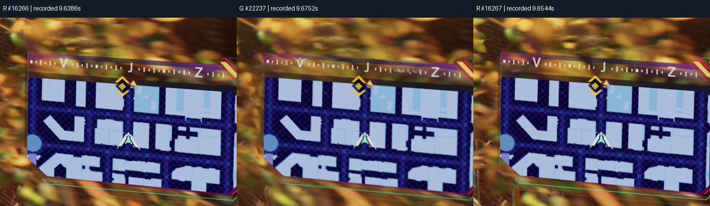
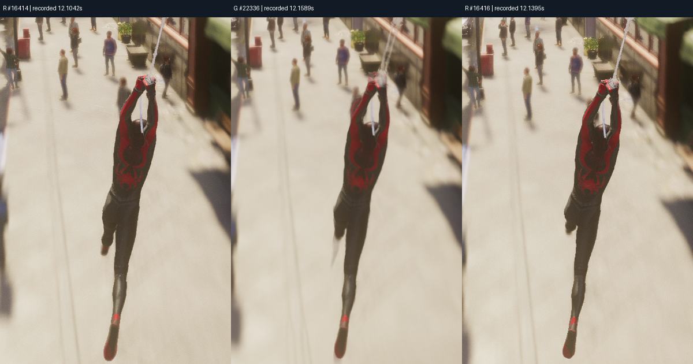

# Pre-fix gameplay example: 79277359

15 seconds, 2560×1440 capture at 60 callbacks/s, 600 distinct input images (~40 FPS). NVIDIA VFG Medium 2×, RTX 5070 Ti, VSync off. 599 generated images; 597 comparable pairs, 13 exact copies of A. Recorder drops: 0.

Submission-ID spacing before the pacing repair: mean 12.50 ms, median 3.08 ms, p95 30.85 ms. This is not even 80-FPS scanout. The capture proves functional generation, with HUD deformation and occlusion softness; it does not prove quality of the new optical backend or repaired scheduler. No intermediate ground truth is available.

Compact comparison/output videos and ID-linked JSON/CSV are prepared under `release-assets/analysis-15s-79277359`, intentionally outside Git history. They can accompany a GitHub release after the destination is selected. Original game footage remains under its respective rights holders, not this source-code license.

## Visible failures (A / generated / B)

