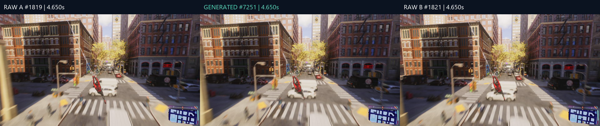
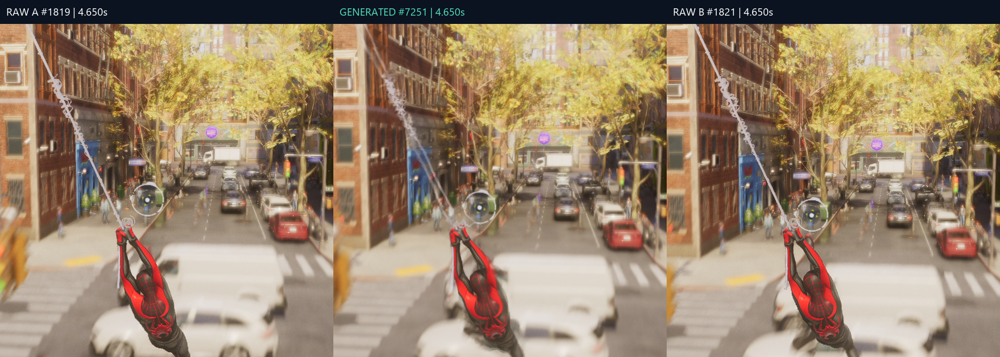
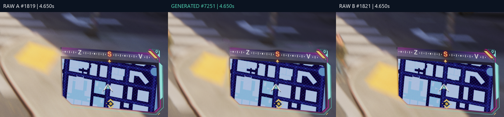
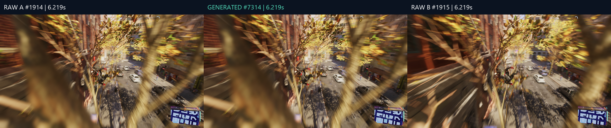

# Porovnání záznamu 82183953

[English](README.md) · [Český návod FrameLabu](../../docs/README.cs.md)

**Generování funguje:** vstup obsahuje přibližně **40 měnících se obrazů/s**, aplikace odeslala **80 ID obrazů/s**. Z dostupných pixelů lze ověřit přibližně **79 změn obrazu/s**. Nejde o měření fyzického zobrazování monitoru.

Záznam: 15 sekund, 2560×1440, 899 vstupních snímků, NVIDIA VFG **Střední / 2×**, RTX 5070 Ti, AVerMedia GC573. VSync vypnutý, deduplikace a automatická detekce střihu zapnuté. Při ukládání se neztratil žádný snímek.

Z 599 generovaných snímků lze 597 porovnat s oběma originály. **587 je odlišných od obou vstupů**, 10 je přesnou kopií A. Dva počáteční mezisnímky odkazují před začátek záznamu. Hodnota 98,32 % znamená podíl odlišných snímků, nikoli procento kvality.

Rozestup odeslaných ID má průměr **12,50 ms**, medián **12,30 ms**, p95 **15,79 ms** a maximum **21,56 ms**. RAW od přijetí po odeslání: průměr **45,36 ms**, p95 **53,42 ms**. Nezahrnuje to latenci konzole, hardwaru střihovky ani monitoru. GPU využití a čas GPU výpočtu nebyly s tímto záznamem uložené jako časová řada.

## Co stáhnout

Release balíček **FrameLab-82183953-comparison-example.zip** je připravený k publikování. Rozbalte ho a otevřete **index.html**. Obsahuje:

- 3 sekundy akce (3.–6. sekunda nahrávky), **4× zpomalené na 12 sekund**, RAW vlevo a VFG vpravo. První video zarovnává čas zdroje a mezisnímku pro prohlížení pohybu.
- Druhé video stejného úseku podle skutečných časů odesílání, včetně zpoždění zpracování. Export žádné nové mezisnímky nevyrábí.
- Celé 15sekundové porovnání, 12 plných PNG a výřezy postavy, pavučiny a HUDu v původních pixelech.
- ID každého snímku, JSON s nastavením, CSV časování, kontrolní součty a screenshot aplikace.

## Co je na obraze vidět

Při houpání přibývají mezilehlé polohy. Zároveň je na mezisnímku 7251 vidět měkčí kresba pavučiny, aut a stromů. Není to bezchybný nárůst kvality: chybí skutečný referenční obraz v mezilehlém čase.

Při prudkém průletu listím se některé generované snímky přesně rovnají A. Příčina může souviset s detekcí střihu, ale SDK ji u konkrétních snímků nezaznamenalo. Tohle je jeden z těch případů:

Vybraný třísekundový úsek neobsahuje kopii A; proto balíček zahrnuje i tyto neúspěšné případy a celé video. Technická metodika, přesná nastavení a příkazy pro reprodukci jsou v [anglickém popisu](README.md).
