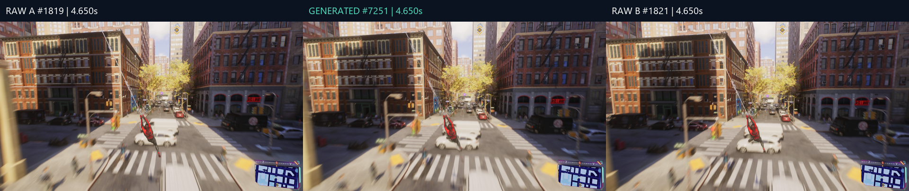
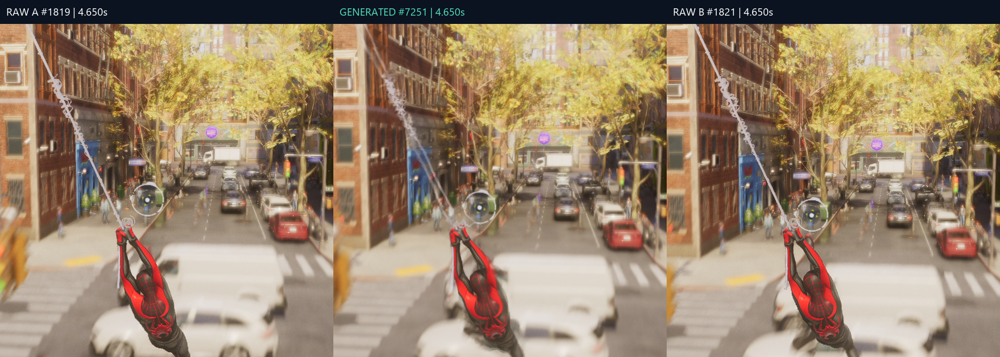
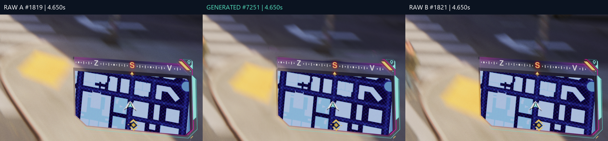
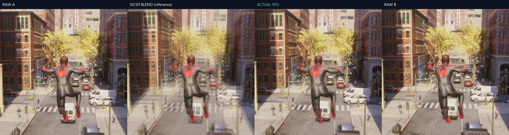
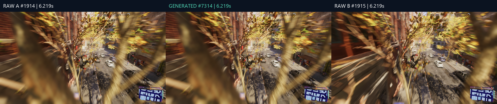

# Gameplay evidence: 82183953

[Česky](README.cs.md) · [FrameLab](../../README.md)

**Generation is real: the recording contains approximately 40 changing source images/s and 80 submitted image IDs/s.** It does not establish perfect interpolation or 80 physical monitor frames/s.

Also see the [separate 4× failure-case recording](../84744531/README.md). It uses different gameplay, so it is not a controlled multiplier comparison.

[Watch / download the 12-second slow-motion movie](https://github.com/tomik520i/FrameLab/releases/download/v0.2.0-preview.6/analysis-15s-82183953_source-aligned_3s_4x-slow.mp4).

## Watch and inspect

Download [FrameLab-82183953-comparison-example.zip](https://github.com/tomik520i/FrameLab/releases/download/v0.2.0-preview.6/FrameLab-82183953-comparison-example.zip), extract it and open **index.html**. It includes:

- **3.0–6.0 seconds of action at 4× slow motion**: 12-second, 60-FPS side-by-side RAW / VFG movie. This version aligns source timestamps and the generated A/B midpoint to expose the added positions; scheduling delay is removed.
- **The same segment using recorded Present timestamps**, retaining processing/queue delay. Neither movie records physical monitor scanout. Every preview frame maps to original image IDs in a companion CSV; export adds no new interpolation.
- Full 15-second matched A/generated/B and output previews; the latter is resampled to 60 FPS.
- Twelve full-resolution PNGs from four matched triplets, native-pixel character/HUD crops and a 50/50-blend comparison.
- Original settings, capture/result JSON, every source/generated frame ID, every submission timestamp, analysis CSV/JSON, file sizes and SHA-256 hashes.
- The user-provided application screenshot and a complete source timeline.

## Recorded configuration

| Parameter | Value |
| --- | --- |
| Recording / settings ID | `analysis-15s-82183953` / `analysis-15s-82183953_settings` |
| Duration | 15 seconds, completed, recorder drops 0 |
| Delivered capture | 2560×1440 BGRA8, 899 frames, 59.93 callbacks/s |
| Capture device | AVerMedia HD Capture GC573 1 |
| GPU / backend | RTX 5070 Ti / NVIDIA VFG |
| Quality / multiplier | Medium / 2× |
| Dedup / automatic cuts / VSync | on / on / off |
| Pacing version | 2; capture metadata does not include a commit or executable hash |
| HDMI wire timing | Unknown; dimensions above describe delivered capture frames |

## Whole-take results

| Measurement | Result |
| --- | --- |
| Distinct captured images | 600 (40.0/s); 299 adjacent repeated captures |
| Generated images | 599; 597 have both source endpoints inside the take |
| Generated images different from both endpoints | 587 / 597 = 98.32% (difference, **not a quality score**) |
| Exact copies of A | 10; clustered at 6.20–6.35s and 11.58–11.68s |
| Submitted image-ID changes | 1200 (80.0/s), including copied outputs and pre-window references |
| Known submitted RGB image epochs | 1185 (79.0/s across the full window); unavailable boundary pixels excluded |
| Image-ID spacing | mean 12.50 ms; median 12.30 ms; p95 15.79 ms; max 21.56 ms |
| RAW callback → RAW submission | mean 45.36 ms; p95 53.42 ms |
| B callback → generated submission | mean 32.52 ms; p95 40.51 ms |
| G followed by wrong B | 0 observed ordering anomalies |

The latency figures exclude source rendering, capture-card buffering and physical display scanout. The generated latency is measured from source B, not from its nominal midpoint. GPU execution time/utilization were not stored as a time series with this take. Diagnostic readback can affect performance.

## Visual findings

The generated positions lie between the source views during the swing. The 7251 character crop also shows softer web strands, background vehicles and tree detail than the captured endpoints. The slow-motion pair makes the additional positions inspectable but does not turn a pixel-difference percentage into an accuracy score. No true reference image at the missing time is available, so PSNR/SSIM would not establish interpolation accuracy here.



Native-pixel crop, same coordinates in every image:





Actual VFG versus a simple 50/50 crossfade (labelled reference, never inserted into the movies):



The fallback example below contains an **exact copy of A** in the generated slot. These happen during rapid motion through foliage. A cut-detection fallback is a possible explanation, but the SDK did not record a reason for these frames.



The 3-second selected clip covers a continuous swing between buildings and contains no endpoint-copy event. Failure examples elsewhere in the full take are included above and in the full release package.

## Reproduce

With the original `app/recordings/analysis-15s-82183953` pixels available locally:

```powershell
python tools/audit_analysis_take.py app/recordings/analysis-15s-82183953
python tools/build_comparison_materials.py app/recordings/analysis-15s-82183953 --start 3 --seconds 3 --slowdown 4
python tools/finalize_comparison_release.py app/recordings/analysis-15s-82183953
```

The compact package retains frame byte offsets and SHA-256 from the original lossless clips; the multi-GB originals remain local. It does not contain all source pixel dumps. Game footage belongs to its respective rights holders and is not licensed by FrameLab's GPL source license.
