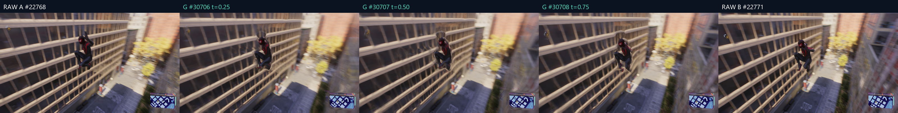
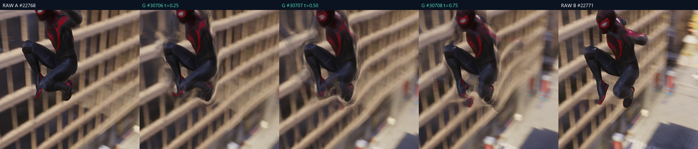
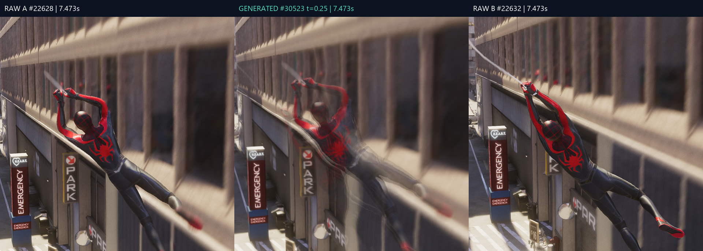

# Záznam 4×: viditelné artefakty a naměřené limity

[English](README.md) · [Český návod FrameLabu](../../docs/README.cs.md)

**Toto je ukázka selhání, nikoli bezchybného obrazu.** Vygenerované snímky zdvojují obrysy postavy, rozmývají končetiny a deformují pozadí. Vyšší FPS samo o sobě neznamená lepší obraz. Původní snímky už obsahují pohybové rozmazání; dodatečné průsvitné obrysy jsou vidět při porovnání se stejnými zdrojovými snímky.

[Stáhnout kompletní porovnání 4×](https://github.com/tomik520i/FrameLab/releases/download/v0.2.0-preview.6/FrameLab-84744531-comparison-example.zip). Rozbalte ZIP a otevřete **index.html**. Obsahuje videa, plné PNG, výřezy, nastavení, ID snímků, potvrzení Windows a kontrolní součty.

Stejný výřez v původních pixelech: zdvojená kolena, chodidla a obrys těla; deformace fasády kolem postavy. Fáze t=0,25 / 0,50 / 0,75 pocházejí ze stejného páru A #22768 a B #22771 vzdálených 58,03 ms. Export nic dalšího negeneroval.

Další viditelný duch postavy při rychlém pohybu:

Videa ukazují **9,5–12,5 s záznamu zpomalené na 12 sekund**. První srovnává podle zdrojového času, druhé zachovává skutečné časování odesílání včetně zpoždění. Zpomalení 4× a násobič frame genu 4× jsou dvě různé věci. CSV umožňuje dohledat původ každého obrazu.

| Měření za celý záznam | Výsledek |
| --- | --- |
| ID / délka | `analysis-15s-84744531` / 15 s, dokončeno |
| Zdroj | AVerMedia GC573, PS5, přijaté 2560×1440; požadavek 60 FPS |
| Režim | RTX 5070 Ti, NVIDIA VFG, Medium, 4×; dedup a detekce střihu zapnuté, VSync vypnutý |
| Uložené vstupy / mezisnímky | 800 / 988; rekordér nezahodil žádný přijatý snímek |
| Skutečné změny vstupních pixelů | 596 = 39,73/s |
| Odeslaná obrazová ID | 1318 = 87,87/s |
| Známé změny odeslaných pixelů | 1257 = 83,80/s |
| Potvrzená ID Windows | 1317 = 87,80/s, z toho 987 generovaných |
| Mezistupně odlišné od obou originálů | 927 / 980 = 94,59 %; nejde o skóre kvality |
| Přesné kopie originálů | 53: 43 kopíruje A, 10 kopíruje B |
| Vstup RAW → odeslání RAW | Průměr 77,84 ms, p95 101,20 ms; nezahrnuje střihovku ani monitor |

Zpracovalo se přibližně **22 párů za sekundu**. Násobič 4× se vztahuje na zpracované páry, takže tady nevzniklo 40×4 = 160 FPS. Nula zahozených snímků rekordéru neznamená, že generátor stihl všechny vstupy. Diagnostické kopírování a komprese mohou výkon snížit.

Starší 2× záznam měl 80 odeslaných ID/s a asi 79 změn pixelů/s, tento 4× má 87,87 ID/s a 83,80 změn pixelů/s. **Jsou to jiné průchody hrou a jiná zátěž nahráváním, nikoli kontrolované porovnání stejného vstupu.** Ukázka dokládá konkrétní vady 4×. Potvrzení Windows není fyzické měření panelu kamerou.

[Testovací sestava a vytížení GPU při běžném živém frame genu](../../docs/test-system.md). Podrobná čísla, omezení a reprodukční příkazy jsou v [anglické verzi](README.md). Herní obraz patří příslušným držitelům práv, nikoli pod GPL licenci zdrojáků FrameLabu.
