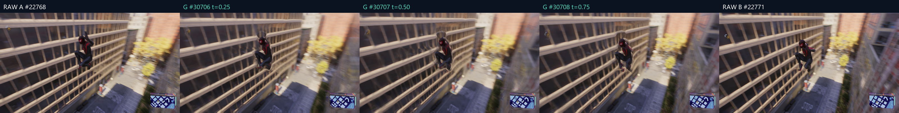
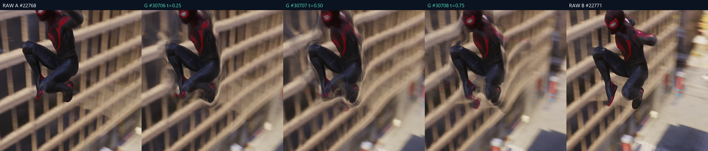
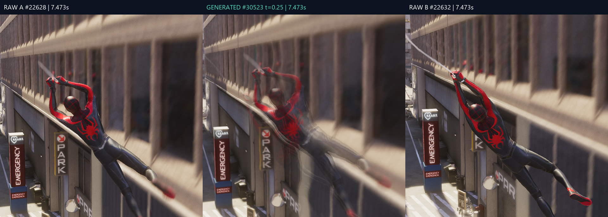
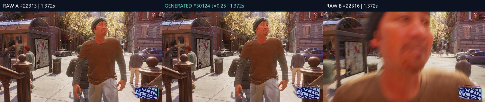

# 4× gameplay: visible artifacts and measured limits

[Česky](README.cs.md) · [FrameLab](../../README.md) · [Earlier 2× take](../82183953/README.md)

**This is a failure-case example, not a quality showcase.** The generated images visibly split and smear the character's limbs and warp the background around moving silhouettes. Higher output FPS does not make these images accurate. The source images already contain motion blur; the additional ghost contours are visible by comparing the recorded A / generated / B pixels.

Download [the complete 4× comparison package](https://github.com/tomik520i/FrameLab/releases/download/v0.2.0-preview.6/FrameLab-84744531-comparison-example.zip), extract it, and open **index.html**. The package contains four videos, full-resolution images, native-pixel crops, original settings, per-frame IDs, Windows confirmations and SHA-256 hashes.

## See all three generated phases

The same source pair, **A #22768 → G #30706 / #30707 / #30708 → B #22771**, at t=0.25 / 0.50 / 0.75. The source endpoints are 58.03 ms apart. These are actual saved images; no additional interpolation or sharpening was applied to the examples.





Open the crop at full size. In the generated phases the knees, feet and body outline acquire extra translucent contours. The middle phase does not provide a clean intermediate pose. The facade behind the silhouette also bends and smears. The endpoints remain motion-blurred, but do not have the same doubled silhouette.

Another failure during fast motion, with an 83.86 ms A/B gap:



Some generated images instead repeat an endpoint. Example G #30124 is an exact copy of A, verified over every RGB pixel:



[Watch / download the 12-second 4× slow-motion movie](https://github.com/tomik520i/FrameLab/releases/download/v0.2.0-preview.6/analysis-15s-84744531_source-aligned_3s_4x-slow.mp4).

## Video comparisons

- **9.5–12.5 seconds**, slowed 4× to a 12-second movie, RAW left and VFG right. Source-aligned reconstruction uses each frame's recorded t=0.25 / 0.50 / 0.75. It removes scheduling delay and can include captured RAW images the generator skipped; it does not reproduce live output cadence.
- The same segment using **actual Present timestamps**, retaining queue/processing delay and skipped input frames.
- Full 15-second A/generated/B and output previews. The latter is resampled to 60 FPS; it cannot reproduce all ~88 submitted image IDs/s at original speed.

Each slow-motion movie has a CSV mapping every video frame to original image IDs. Playback slow motion **4×** and generation multiplier **4×** are separate settings.

## Configuration and measurements

| Parameter | Recorded value |
| --- | --- |
| Recording / settings ID | `analysis-15s-84744531` / `analysis-15s-84744531_settings` |
| Duration | 15 seconds, completed; recorder drops 0 |
| Capture device | AVerMedia HD Capture GC573 1; PS5 gameplay source |
| Delivered capture | 2560×1440 BGRA8; requested 60 FPS; actual 800 frames = 53.33 callbacks/s |
| GPU / backend / quality | NVIDIA RTX 5070 Ti / NVIDIA VFG / Medium |
| Multiplier / dedup / cut detection / VSync | 4× / on / on / off |
| Source pixel changes | 596 = 39.73/s; 204 adjacent repeats |
| Generated images | 988, from 330 A/B pairs including boundary pairs (~22 pairs/s) |
| Comparable generated images | 980; 8 have source endpoints outside the recording |
| Different from both endpoints | 927 / 980 = 94.59%; **not a quality score** |
| Exact endpoint copies | 53: 43 equal A, 10 equal B |
| Submitted image-ID changes | 1318 = 87.87/s |
| Known submitted RGB changes | 1257 = 83.80/s; unavailable boundary pixels excluded |
| Windows-confirmed image-ID changes | 1317 = 87.80/s, including 987 generated IDs = 65.80/s |
| Known RGB changes among confirmed IDs | 1256 = 83.73/s; not camera-measured scanout |
| ID interval | Mean 11.38 ms; p95 17.71 ms; max 22.51 ms |
| RAW callback → RAW submission | Mean 77.84 ms; p95 101.20 ms |
| Source B callback → generated submission | Mean 54.81 ms; p95 79.70 ms |
| Observed G→B ordering anomalies | 0 |
| Recording RAM | 26.37 GB original pixels → 17.75 GB lossless compressed storage |

The 4× setting applies to the pairs actually processed. During this diagnostic take only ~22 pairs/s were processed, so **40×4=160 output FPS was not achieved**. Zero recorder drops means accepted diagnostic frames were saved; it does not mean no input images were skipped by the generation pipeline. Recording/readback/compression can reduce throughput. The measurements do not isolate the limiting CPU/GPU operation.

Windows confirmations provide sampled OS evidence that image IDs reached display presentation. They are not a physical camera measurement; copied pixels can have new IDs. Latency excludes source rendering, capture-card buffering and display scanout. The source HDMI wire timing is not exposed by this API.

## Compared with the earlier 2× recording

| Metric | 2× take 82183953 | 4× take 84744531 |
| --- | ---: | ---: |
| Captured pixel changes/s | 40.00 | 39.73 |
| Submitted image IDs/s | 80.00 | 87.87 |
| Known submitted RGB changes/s | 79.00 | 83.80 |
| Exact endpoint copies | 10 / 597 | 53 / 980 |
| RAW → submission mean | 45.36 ms | 77.84 ms |

**These are different gameplay runs and different diagnostic overhead, not a controlled same-input 2× versus 4× benchmark.** The new take demonstrates severe 4× failure cases, not a universal numeric quality ranking. No true missing-time reference images exist, so PSNR/SSIM against an endpoint would not establish interpolation accuracy. Start with 2×; treat 3×/4× as experimental.

See the [test system and live GPU measurements](../../docs/test-system.md) for the hardware and normal operation without diagnostic recording.

## Reproduce

With the original lossless recording available locally:

```powershell
python tools/audit_analysis_take.py app/recordings/analysis-15s-84744531
python tools/build_comparison_materials.py app/recordings/analysis-15s-84744531 --start 9.5 --seconds 3 --slowdown 4 --sample-id 30707 --sample-id 30706 --sample-id 30708 --sample-id 30523 --sample-id 30835 --sample-id 30124
python tools/build_phase_strip.py app/recordings/analysis-15s-84744531 --generated-id 30707
python tools/finalize_comparison_release.py app/recordings/analysis-15s-84744531
```

The compact release excludes the multi-GB originals but retains their hashes and byte offsets. Game footage belongs to its respective rights holders; FrameLab's GPL source license does not license game assets.
